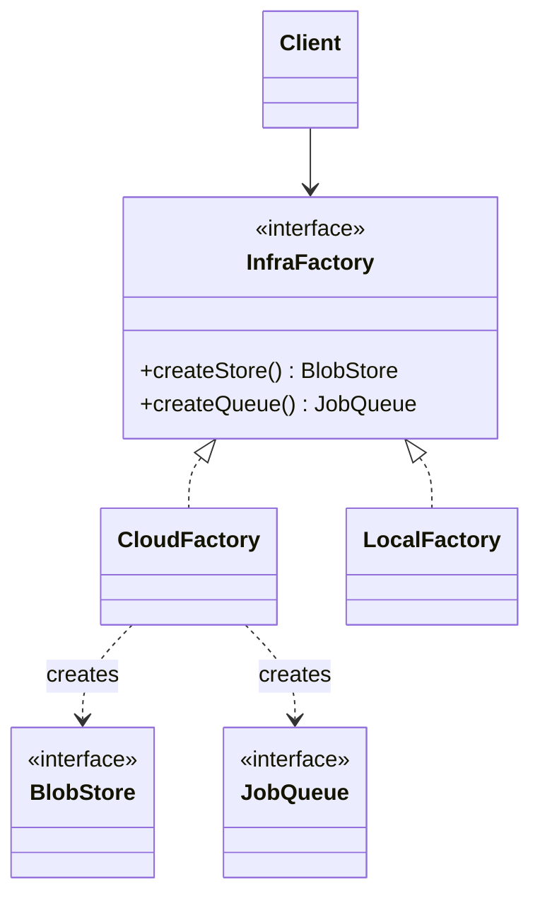

# Abstract Factory

**Category:** Creational
**Also known as:** Kit
**Source:** https://refactoring.guru/design-patterns/abstract-factory

## Intent

Create groups of related objects that must work together, without the client naming their concrete classes. One factory object guarantees that all objects it returns belong to the same variant.

## Signals in code

- Two or more `switch` statements on the same environment key, each picking a different related class. Search: `grep -rnE "(case|===?) ['\"](aws|gcp|local|azure)['\"]" <src-dir>`.
- A bug class where objects from different variants were mixed. Example: a production queue client paired with an in-memory blob store.
- Parallel class names with a shared prefix across several kinds. Example: `S3Storage`, `SqsQueue`, `LocalStorage`, `LocalQueue`.
- Test setup builds many fakes by hand and must keep them consistent with each other.
- One class has three or more factory methods, and creation code hides its main responsibility.
- Adding a new provider or theme means edits in many files that all check the same flag.

## Do not use when

- There is only one product kind. Use a Factory Method or a factory function.
- There is only one variant in production and one fake in tests. Inject the objects directly from the composition root.
- Products do not need to match each other. Inject each dependency on its own.
- New product kinds appear often. Each new kind changes the factory interface and every concrete factory. Use a registry map (`Record<Kind, () => Product>`) instead. Use this only if the products do not need to match. If they must match, accept the interface change.
- The DI container already binds a whole module per environment. Use container modules, not a hand-written factory class.

## Shape

- **Abstract Product:** one interface per product kind.
- **Concrete Product:** one implementation per kind and per variant.
- **Abstract Factory:** an interface with one creation method per product kind.
- **Concrete Factory:** creates all products for one variant.
- **Client:** uses only the abstract factory and abstract products.



## Refactoring path

1. Make a matrix: product kinds as rows, variants as columns. If the matrix has one row or one column, stop and use a simpler pattern.
2. Extract Interface for each product kind. Change call sites to depend on the interfaces.
3. Introduce one factory interface with one creation method per kind.
4. Extract Class: move the constructor calls for one variant into one concrete factory. Repeat for each variant.
5. Create the factory once at startup, from configuration. Pass it to the classes that create products.
6. Replace each `new ConcreteProduct()` and each environment `switch` with a call to the factory. Do one call site per commit.
7. Delete the scattered environment checks.

**Stop point:** after steps 5 and 6 for one client class, with only the fake variant done. A `FakeInfraFactory` in tests already removes duplicated setup and proves the interface.

## Adaptations

- **Default for TypeScript/JavaScript and Python:** a plain object of factory functions. Example: `const local: Infra = { store: () => new MemStore(), queue: () => new MemQueue() }`. A type or Protocol checks completeness.
- **Functional style:** a record of closures that share configuration captured at creation time.
- **Go:** a struct with function fields, or an interface with one method per kind. Build it in `main` and pass it down.
- **Rust:** a trait with associated types (`type Store: BlobStore`) gives compile-time family matching with no dynamic dispatch.
- **Java/C#/Kotlin:** the interface form is idiomatic. Bind one implementation per profile (Spring `@Profile`, .NET environment-based registration).
- **DI containers:** a module per environment that binds all related interfaces at once is the container-native form. Prefer it when a container exists.
- **React:** a context that provides a set of related components or services (a theme kit, an API client set) is an Abstract Factory.

## At architecture scale

- Ports and adapters: one adapter set per deployment target (cloud, on-premises, local). The composition root picks the set.
- Multi-cloud or multi-tenant platforms expose a provider kit with storage, queue and secrets clients that must match.
- Worth it when you run two or more real environments with different infrastructure. Not worth it for a speculative second cloud. That is a cost with no current return.

## Trade-offs

**Gains:**
- Products from one factory always match.
- Client code does not change when a new variant is added.
- One place to switch the whole environment, including tests.

**Costs:**
- A new product kind changes every concrete factory.
- Many interfaces and classes for a matrix that is often small.
- Indirection hides which concrete class runs at a call site.

## Neighbors

- **Factory Method**: creates one product through subclass override, not a family through a factory object. Ask: are there two or more product kinds that must match?
- **Builder**: assembles one complex object in steps before it returns it. Ask: is the problem consistency across objects or assembly of one object?
- **Facade**: hides how a subsystem works, not only how its objects are created. Ask: does the client need to call the subsystem, or only to get objects from it?
- **Bridge**: an Abstract Factory can choose the implementation that matches a Bridge abstraction. Ask: is the pairing between abstraction and implementation fixed per environment?

Often combined with: Factory Method, Prototype, Bridge, dependency injection.

## Minimal example

```ts
interface BlobStore { put(key: string, data: string): Promise<void>; }
interface JobQueue { enqueue(job: string): Promise<void>; }

interface InfraFactory {
  createStore(): BlobStore;
  createQueue(): JobQueue;
}

class MemoryFactory implements InfraFactory {
  private blobs = new Map<string, string>();
  private jobs: string[] = [];
  createStore(): BlobStore {
    return { put: async (k, d) => { this.blobs.set(k, d); } };
  }
  createQueue(): JobQueue {
    return { enqueue: async (j) => { this.jobs.push(j); } };
  }
}

// A CloudFactory implements the same interface with real SDK clients.

class ThumbnailService {
  private store: BlobStore;
  private queue: JobQueue;
  constructor(infra: InfraFactory) {
    this.store = infra.createStore();
    this.queue = infra.createQueue();
  }
  async upload(id: string, image: string) {
    await this.store.put(`raw/${id}`, image);
    await this.queue.enqueue(`thumbnail:${id}`);
  }
}

const service = new ThumbnailService(new MemoryFactory());
```
