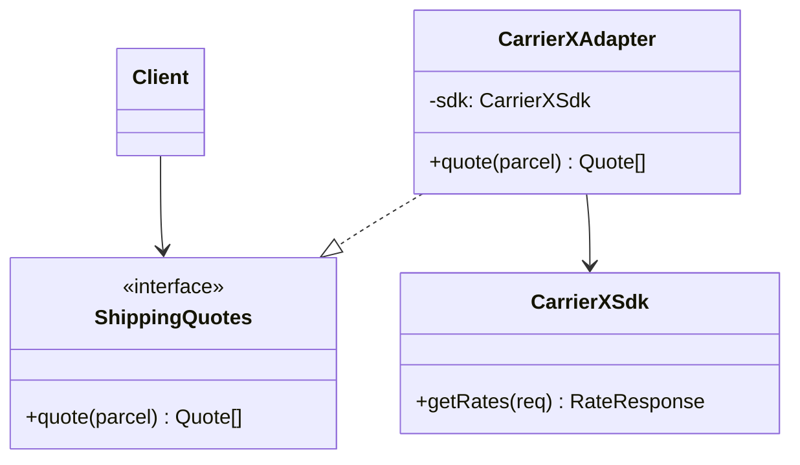

# Adapter

**Category:** Structural
**Also known as:** Wrapper, Translator
**Source:** https://refactoring.guru/design-patterns/adapter

## Intent

Put a thin translator between your code and a component whose interface does not match what your code expects. Your code depends on an interface it owns, and the translation lives in one place.

## Signals in code

- Calls to a vendor SDK appear in many business files. Search: `grep -rn "from 'stripe'\|require('aws-sdk')" <src-dir> | wc -l`.
- The same field mapping repeats near each call site, for example `amount_cents / 100` or `snake_case` to `camelCase` conversion.
- Vendor types leak into domain signatures, for example a domain function that takes `Stripe.Charge` or returns an ORM row.
- Tests mock a third-party library module directly because no seam of your own exists. Search: `grep -rn "jest.mock('" <test-dir>`.
- Two providers do the same job and the code branches on the provider name. Search: `grep -rnE "provider ?(===|==) ?['\"]" <src-dir>`.
- Error handling catches vendor-specific exception classes in business code.
- A planned vendor migration has an estimate that scales with the number of call sites.

## Do not use when

- You own the other component and can change it. Change its interface instead.
- There is one call site and no plan to swap the dependency. A small mapping function next to the call is enough.
- The mismatch is only a data shape. Write a pure `toDomain(raw)` function instead of a class.
- The vendor API already matches your needs and your types. A pass-through wrapper adds a file and no value.
- You want to add behavior with the same interface. That is Decorator or Proxy, not Adapter.

## Shape

- **Client:** business code. It calls only the target interface.
- **Target:** the interface that the client owns and names in its own vocabulary.
- **Adapter:** implements the target. It holds the adaptee and translates calls, data and errors.
- **Adaptee:** the existing component with the incompatible interface. It does not know the adapter exists.



## Refactoring path

1. Find all call sites of the foreign API. Record the operations that the business code uses.
2. Write characterization tests around one call site. Capture current inputs, outputs and errors.
3. Extract Interface: declare the target interface in the domain module. Use domain names and domain types only.
4. Create the adapter class. Move the first call and its mapping into it (Move Method).
5. Inject the adapter through the constructor or the composition root. Do not create it inside business code.
6. Translate vendor errors into domain errors inside the adapter.
7. Migrate the remaining call sites one per commit. Delete each local mapping after you migrate it.
8. Add a lint rule that blocks vendor imports outside the adapter folder, for example `no-restricted-imports`.

**Stop point:** after step 5, new code uses the interface and old call sites still work. That partial state has value. You can finish the migration later, file by file.

## Adaptations

- **TypeScript/JavaScript (default):** a plain object literal or a factory function that returns the target type. Use a class only when the adapter holds state such as a client or a token.
- **Python:** a module of functions, or a class that satisfies a `typing.Protocol`. Structural typing removes the need for an explicit base class.
- **Go:** a small struct that satisfies an interface declared on the consumer side. Go idiom already puts the interface next to the client.
- **Rust:** a newtype wrapper with `impl Trait`, or `impl From<VendorType> for DomainType` for data-only mismatches.
- **Java/C#/Kotlin:** an object adapter with composition. Avoid class adapters through inheritance. They couple you to the vendor class hierarchy.
- **Data-only mismatch in any language:** a pure mapping function. This is the lightest form and often the correct one.

Recommend by default: one target interface per capability, implemented by a factory function or a small class.

## At architecture scale

- **Ports and adapters (hexagonal):** the domain declares ports. Adapters for HTTP, the database and vendors sit outside and implement them. This is the Adapter pattern applied to every boundary.
- **Anti-corruption layer (DDD):** a set of adapters and translators that protects your model from a legacy or partner model. Use it when the other model is large, unstable or semantically different.
- **Integration service or connector:** a separate deployable that translates a partner protocol (SOAP, SFTP files, EDI) into your events or REST API.
- **Strangler fig and branch by abstraction:** the adapter translates the new system's interface into the one existing callers use. A routing layer (proxy, gateway or facade, see refactoring-playbook.md) picks old or new per slice.

The architecture form is worth it when the external model changes often, or when more than one team depends on it. It is not worth it for a stable library with a clean API. In that case, a port for each external system adds indirection with no protection.

## Trade-offs

**Gains:**
- Vendor changes touch one folder.
- Business code and tests use your own types.
- You can swap or add providers without edits to clients.

**Costs:**
- One more interface and one more class per external dependency.
- The adapter can hide vendor features that a client later needs.
- A leaky adapter that passes vendor types through gives the cost without the benefit.

## Neighbors

- **Facade**: Facade defines a new simple interface over many objects, while Adapter conforms one object to an existing interface. Ask: does a client-owned interface already exist that the wrapper must satisfy?
- **Decorator**: Decorator keeps the same interface and adds behavior. Ask: does the wrapper change the interface or only the behavior?
- **Proxy**: Proxy keeps the same interface and controls access. Ask: is the wrapped object already compatible with the client?
- **Bridge**: Bridge is designed up front to vary two dimensions, while Adapter fixes a mismatch after the fact. Ask: did you plan this seam, or did you discover it?

Often combined with: Facade (adapter behind a facade), Factory Method (select the adapter by configuration), Strategy (adapters as interchangeable providers).

## Minimal example

The `{ cause }` option of `Error` needs `lib: es2022` or later in `tsconfig.json`.

```ts
// Target interface, owned by the domain.
export interface ShippingQuotes {
  quote(parcel: { weightKg: number; toZip: string }): Promise<Quote[]>;
}
export type Quote = { carrier: string; priceCents: number; days: number };

// Adaptee: vendor SDK with its own shapes and units.
type CarrierXRate = { svc_name: string; total: string; eta_hours: number };
declare class CarrierXSdk {
  getRates(req: { wt_lb: number; dest_postal: string }): Promise<CarrierXRate[]>;
}

// Adapter: translates units, names and errors in one place.
export class CarrierXQuotes implements ShippingQuotes {
  constructor(private readonly sdk: CarrierXSdk) {}

  async quote(parcel: { weightKg: number; toZip: string }): Promise<Quote[]> {
    try {
      const rates = await this.sdk.getRates({
        wt_lb: parcel.weightKg * 2.20462,
        dest_postal: parcel.toZip,
      });
      return rates.map((r) => ({
        carrier: `carrierx:${r.svc_name}`,
        priceCents: Math.round(Number(r.total) * 100),
        days: Math.ceil(r.eta_hours / 24),
      }));
    } catch (err) {
      throw new Error("Shipping quote unavailable", { cause: err });
    }
  }
}
```
