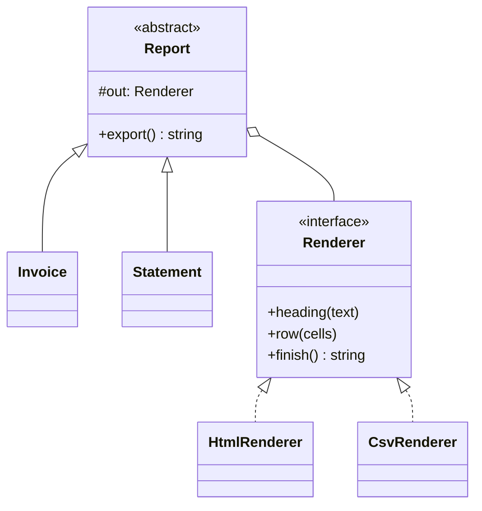

# Bridge

**Category:** Structural
**Also known as:** Handle/Body
**Source:** https://refactoring.guru/design-patterns/bridge

## Intent

Split one class hierarchy that varies along two independent axes into two hierarchies joined by composition. Each axis then grows on its own, and the class count grows by addition instead of multiplication.

## Signals in code

- Class names that combine two words from two lists, for example `PdfInvoiceExporter`, `HtmlInvoiceExporter`, `PdfStatementExporter`. Search: `grep -rhoE "class (Pdf|Html|Csv)[A-Z][a-zA-Z]+" src/ | sort`.
- A new value on one axis needs one new subclass for every value on the other axis.
- Subclasses that duplicate the same low-level code and differ only in the high-level steps, or the reverse.
- A `switch` on a platform, driver or backend inside methods that also contain business rules. Search: `grep -rnE "switch ?\((this\.)?(driver|backend|platform|format)"`.
- Feature flags or config values that pick a backend in many places instead of in one place.
- A refactor ticket that says "support a second database" or "add a second renderer" and estimates many files.

## Do not use when

- Only one axis varies. Use Strategy or plain polymorphism instead.
- The second axis has one value today and no concrete plan for a second. Wait until it exists (YAGNI).
- The two axes are not independent, because each high-level variant works with only one low-level variant. Keep them together.
- The class is small and cohesive. Splitting it scatters logic with no gain. Leave it as one class.
- A function parameter covers the variation. Pass a renderer function or a config map.

## Shape

- **Abstraction:** high-level logic. It holds a reference to an implementor and calls only its interface.
- **Refined Abstraction:** a variant of the high-level logic.
- **Implementor:** an interface of primitive operations. It need not match the abstraction interface.
- **Concrete Implementor:** a platform, driver or backend that implements the primitives.
- **Client:** picks one abstraction and one implementor and connects them.



## Refactoring path

1. List the subclasses as a grid. Name the two axes, for example "document kind" and "output format".
2. Write characterization tests that snapshot the output of each existing combination.
3. Pick the axis with the lower-level operations. That axis becomes the implementor.
4. Extract Interface: declare the primitive operations that the high-level code calls on that axis.
5. Extract Class: move the format-specific code from one subclass into a concrete implementor.
6. Replace Inheritance with Delegation: give the base class a field of the implementor type. Inject it through the constructor.
7. Collapse the duplicates. `PdfInvoiceExporter` and `HtmlInvoiceExporter` become one `Invoice` with two renderers.
8. Repeat for each combination. Delete each old subclass when its tests pass on the new pair.
9. Move the pairing decision to one place, such as a factory or the composition root.

**Stop point:** after step 6 for one axis value, new combinations can use the bridge. Old subclasses can stay until you touch them.

## Adaptations

- **TypeScript/JavaScript (default):** pass the implementor as a constructor parameter typed with an interface. Keep the abstraction side as classes only if it has real variants. Otherwise make it a function that takes the implementor.
- **Functional style:** the abstraction is a higher-order function that receives an object of primitive functions. For example, `exportInvoice(invoice, renderer)`.
- **Python:** a `Protocol` for the implementor and plain functions or classes for the abstraction.
- **Go:** an interface field in a struct. This is idiomatic Go and needs no pattern name.
- **Rust:** a generic parameter `Report<R: Renderer>` for static dispatch, or `Box<dyn Renderer>` for runtime choice.
- **Java/C#/Kotlin:** inject the implementor through the DI container. Register one implementor per environment or tenant.

Recommend by default: an injected interface on the low-level axis, and a function or one class on the high-level axis.

## At architecture scale

- **Driver or provider model:** an application API calls a driver interface. JDBC, database ORMs with dialects, and logging back ends follow this shape.
- **Ports and adapters:** when one domain service has several variants and each port has several adapters, the port is a bridge between two axes. Most hexagonal code has one domain side and is plain Adapter. See adapter.md.
- **Cross-platform clients:** shared UI or business logic on top of a per-platform layer for storage, push messages or file access.
- **Multi-cloud or multi-vendor platforms:** a platform API over provider modules, for example Terraform providers.

The architecture form is worth it when two or more implementations exist in production now. It is not worth it as insurance against a vendor change that no one has scheduled.

## Trade-offs

**Gains:**
- Class count grows as M + N instead of M x N.
- Each axis changes and ships on its own.
- You can choose the implementor at runtime or per environment.

**Costs:**
- One more level of indirection on every call.
- The primitive interface is hard to design well. A bad cut forces both sides to change together.
- Over-engineering when the second axis never gets a second value.

## Neighbors

- **Strategy**: Strategy swaps one algorithm behind one interface, while Bridge separates two whole hierarchies. Ask: do both sides have their own variants?
- **Adapter**: Adapter fixes a mismatch after the fact, while Bridge is a planned seam. Ask: are you designing this split, or patching an incompatibility?
- **Abstract Factory**: Abstract Factory can create matching implementors for an abstraction. Ask: do some pairs fail when mixed?
- **State**: State changes the delegate as the object changes state. Ask: does the delegate change during the object lifetime because of internal events?

Often combined with: Abstract Factory (create valid pairs), Builder (director as abstraction, builders as implementors), Adapter (wrap a vendor to make it an implementor).

## Minimal example

```ts
// Implementor: primitive output operations.
interface Renderer {
  heading(text: string): void;
  row(cells: string[]): void;
  finish(): string;
}
class CsvRenderer implements Renderer {
  private lines: string[] = [];
  heading(text: string) { this.lines.push(`# ${text}`); }
  row(cells: string[]) { this.lines.push(cells.join(",")); }
  finish() { return this.lines.splice(0).join("\n"); }
}
class HtmlRenderer implements Renderer {
  private parts: string[] = [];
  heading(text: string) { this.parts.push(`<h1>${text}</h1>`); }
  row(cells: string[]) { this.parts.push(`<p>${cells.join(" | ")}</p>`); }
  finish() { return this.parts.splice(0).join(""); }
}

const money = (cents: number) => (cents / 100).toFixed(2);
// Abstraction: high-level report logic, unaware of the format.
abstract class Report {
  constructor(protected readonly out: Renderer, protected readonly lines: { label: string; cents: number }[]) {}
  abstract export(): string;
}
class Invoice extends Report {
  export() {
    this.out.heading("Invoice");
    this.lines.forEach((l) => this.out.row([l.label, money(l.cents)]));
    this.out.row(["TOTAL", money(this.lines.reduce((s, l) => s + l.cents, 0))]);
    return this.out.finish();
  }
}
class Statement extends Report {
  export() {
    this.out.heading("Statement");
    let balance = 0;
    this.lines.forEach((l) => this.out.row([l.label, money((balance += l.cents))]));
    return this.out.finish();
  }
}
// 2 reports + 2 renderers = 4 classes for 4 combinations. A third renderer adds 1 class, not 2.
const html = new Statement(new HtmlRenderer(), [{ label: "fee", cents: -250 }]).export();
const csv = new Invoice(new CsvRenderer(), [{ label: "A-1", cents: 1250 }]).export();
```
