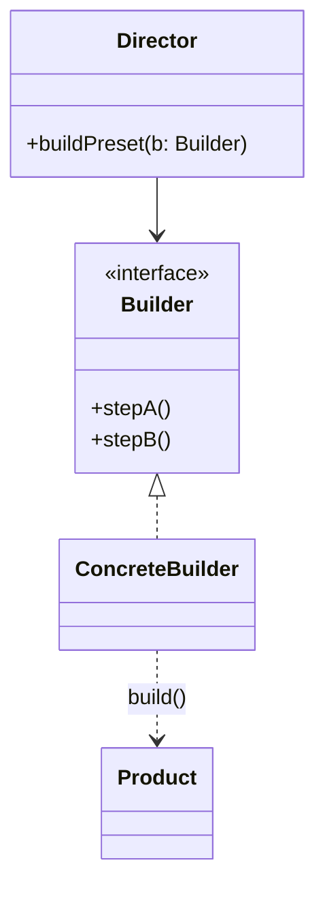

# Builder

**Category:** Creational
**Also known as:** none
**Source:** https://refactoring.guru/design-patterns/builder

## Intent

Separate the step-by-step assembly of a complex object from the object itself. The client calls only the steps it needs, and it gets a finished, valid object at the end.

## Signals in code

- A constructor or function with five or more parameters, many of them optional or `undefined`. Search: `grep -nE "new \w+\((\w+, ){5,}"`.
- Call sites that pass positional `null`, `undefined` or `false` to skip arguments. Search: `grep -nE "\((.*, )?(null|undefined), (null|undefined)"`.
- Several overloaded constructors that call each other with default values (telescoping constructors).
- An object built in many statements, with fields set one by one after `new`, and partly built objects passed around.
- Validation for field combinations is repeated at each call site, or missing.
- Test files repeat large literal objects with small differences.
- The same assembly sequence must output different formats (an SQL string, a request body, a debug view).

## Do not use when

- The object has few fields, or all fields are required. Use a constructor or a typed options object.
- The language has named arguments with defaults (Python, Kotlin, C#). Use them.
- In TypeScript the only problem is many optional fields. Use an options object with a `Partial<T>` and defaults spread in.
- The object is plain data with no invariants. Use an object literal or a record with `with` copies.
- You only need presets. Use a function per preset or a Prototype.

## Shape

- **Builder:** declares the construction steps.
- **Concrete Builder:** implements the steps and holds the product in progress. It returns the result through `build()`.
- **Product:** the finished object. Different builders can return unrelated product types.
- **Director (optional):** runs a fixed sequence of steps to produce a named configuration.



## Refactoring path

1. Find the constructor with too many parameters. List which parameters are required and which are optional.
2. Introduce Parameter Object first. Replace the parameter list with one typed options object. Often this solves the problem, so stop here.
3. If assembly has order rules or cross-field validation, Extract Class: create a builder with one method per optional part.
4. Make the builder methods return `this` for chaining. Put required parameters in the builder constructor.
5. Move cross-field validation into `build()`.
6. Replace call sites one by one. If you need a compatibility shim, add a deprecated static `Product.fromLegacy(a, b, c)` that delegates to the builder. Do not wrap the constructor itself.
7. When no call site uses the old constructor, make it private or package-internal.
8. If the same sequence repeats at many call sites, Extract Method into a director function or a named preset.

**Stop point:** after step 2. A parameter object removes most of the pain at very low cost. Continue only if invariants or multiple outputs justify a builder.

## Adaptations

- **Default for TypeScript/JavaScript:** an options object with defaults and a factory function that validates. Use a fluent builder only for query-like objects or when steps are conditional and many.
- **Python:** keyword arguments with defaults, or `dataclasses.replace()` for variations. A builder is rarely needed.
- **Go:** functional options (`New(required, WithTimeout(5*time.Second), WithRetries(3))`). This is the idiomatic Go builder.
- **Rust:** the builder pattern is idiomatic because Rust has no default or named arguments. Crates like `derive_builder` generate it. Typestate builders can enforce required steps at compile time.
- **Java/C#/Kotlin:** Lombok `@Builder` (also works on records). Kotlin and C# named and default arguments remove most needs.
- **Test data builders:** a builder with valid defaults (`anOrder().withItems(3).build()`) is a strong use case in any language.
- **Framework-native:** query builders (Knex, SQLAlchemy Core, jOOQ) and HTTP request builders already follow this pattern. Use them rather than writing your own.

## At architecture scale

- Pipeline or workflow definitions built step by step, then frozen and validated before deploy.
- Infrastructure-as-code constructs and CI configuration generators assemble a large spec from small steps.
- A request assembler that collects data from several services before it emits one command.
- Worth it when a large spec has invariants that must hold before execution. Not worth it for a configuration file that a schema validator can check.

## Trade-offs

**Gains:**
- Readable call sites with named steps instead of positional arguments.
- One place for validation, so no partly built object escapes.
- One sequence of steps can produce different outputs.

**Costs:**
- More code: one builder per product, often mirroring each field.
- Fields can drift between product and builder.
- Required fields are not checked at compile time unless you add typestate tricks.

## Neighbors

- **Abstract Factory**: returns finished objects at once, in matching families. Ask: does the client need to configure one object in several steps?
- **Factory Method**: picks which class to create, not how to assemble it. Ask: is the hard part choosing the type or assembling the parts?
- **Prototype**: starts from a configured copy instead of from empty. Ask: are most objects small variations of a few presets?
- **Composite**: a builder with recursive steps is a clean way to assemble a Composite tree. Ask: is the product a tree?

Often combined with: Composite, Director as a plain function, test data builders.

## Minimal example

```ts
type Filter = { field: string; op: "=" | ">" | "<"; value: string | number };

type SearchQuery = Readonly<{
  index: string;
  filters: readonly Filter[];
  sort?: string;
  limit: number;
}>;

class SearchQueryBuilder {
  private filters: Filter[] = [];
  private sortBy?: string;
  private max = 20;
  constructor(private readonly index: string) {}

  where(field: string, op: Filter["op"], value: Filter["value"]): this {
    this.filters.push({ field, op, value });
    return this;
  }
  orderBy(field: string): this { this.sortBy = field; return this; }
  take(n: number): this { this.max = n; return this; }

  build(): SearchQuery {
    if (this.max < 1 || this.max > 500) throw new Error("limit out of range");
    if (this.sortBy && this.filters.some((f) => f.field === this.sortBy && f.op === "=")) {
      throw new Error("sorting on a field fixed by '=' has no effect");
    }
    return Object.freeze({ index: this.index, filters: [...this.filters], sort: this.sortBy, limit: this.max });
  }
}

const query = new SearchQueryBuilder("tickets")
  .where("priority", ">", 2).orderBy("createdAt").take(50).build();
```
