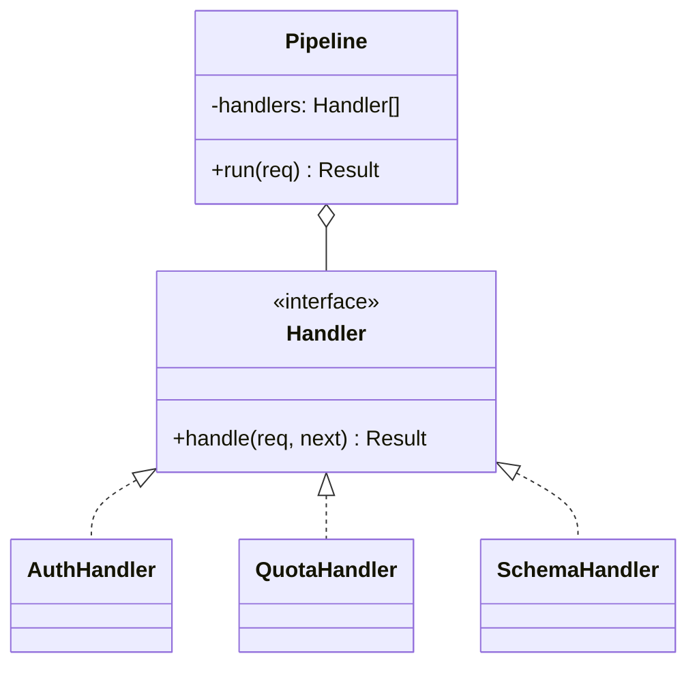

# Chain of Responsibility

**Category:** Behavioral
**Also known as:** CoR, Chain of Command, pipeline, middleware
**Source:** https://refactoring.guru/design-patterns/chain-of-responsibility

## Intent

Put each step that can act on a request into its own handler, and connect the handlers in a sequence. Each handler can act, pass the request on, or stop the flow, so the sender does not know which step does the work.

## Signals in code

- One long function runs a sequence of guard checks with early returns: auth, rate limit, schema validation, cache lookup, then the real work. Search: `grep -rnE "if \(!.*\) (return|throw)" -A1 <src-dir>` in request handlers.
- Two or more entry points copy the same subset of checks in a different order. Search for repeated calls such as `grep -rn "checkRateLimit\|verifyToken\|validateSchema" <src-dir>`.
- A change to one check breaks another check because they share local variables in the same function.
- A dispatcher tries a list of parsers, resolvers or pricing rules until one returns a value. Search: `grep -rnE "for .* of (handlers|resolvers|rules|parsers)" <src-dir>`.
- Feature flags turn individual checks on and off inside one big method.
- An event must bubble from a child element up through its parents until one parent handles it.

## Do not use when

- The sequence has two or three fixed steps that never change order. Keep plain sequential calls in one function.
- Every step must always run and none can stop the flow. Use a list of functions and a `for` loop, or function composition.
- The framework already has a middleware or interceptor stack (Express, Koa, Fastify hooks, ASP.NET middleware, Spring filters, Django middleware). Register a middleware. Do not build a second chain.
- A key that you know up front selects exactly one handler. Use a map from key to handler. A chain makes a lookup into a linear scan.
- You need to know which handler will run before you send the request. A chain hides that decision. Use explicit dispatch.

## Shape

- **Handler**: the contract. It takes a request and either returns a result or delegates to the next handler.
- **Concrete handler**: one check or one transformation. It decides to act, to pass on, or to stop.
- **Next link**: a reference to the following handler, or a `next()` function that a runner injects.
- **Client / builder**: assembles the chain from configuration and sends the request to the first link.



## Refactoring path

1. Cover the current function with characterization tests. Include one test per early return path.
2. Introduce Parameter Object. Put all inputs the checks read into one request or context object.
3. Extract Method for each check. Give each method the same signature, for example `(ctx) => Result | undefined`.
4. Put the extracted methods into an ordered array. Replace the inline sequence with a loop that stops at the first defined result.
5. Stop point: the array of functions already gives reorder, reuse and isolated tests. Many codebases need nothing more.
6. If a handler must run code after the next one (timing, retries, transactions), change the signature to `(ctx, next)`. This is the middleware form.
7. Extract Interface only when handlers need state or dependencies. Then use classes with constructor injection.
8. Move chain assembly into a builder or into configuration. Each entry point then selects its own subset of handlers.
9. Add a terminal handler or a default result so that no request reaches the end of the chain unhandled.

## Adaptations

- **Functional default (recommended for TS/JS and Python):** an array of functions plus a small runner. Use `(ctx, next) => Promise<Result>` when handlers wrap the rest of the chain.
- **TypeScript/JavaScript:** Express, Koa, Hono and Fastify are chains. Write a middleware or a route-level hook. Use validation libraries (Zod `.pipe`, class-validator) for field rules instead of handler classes.
- **Python:** a list of callables, or decorators that wrap a view. Django and ASGI middleware are the framework forms.
- **Go:** `func(http.Handler) http.Handler` wrappers composed with a helper. Use `chi` or `alice` style chaining.
- **Java/C#/Kotlin:** servlet filters, Spring `HandlerInterceptor`, ASP.NET `app.Use(...)`, MediatR pipeline behaviors. Prefer these to a hand-made linked list.
- **Rust:** `tower::Layer` and `Service` for network stacks. Use an iterator with `find_map` for "first handler that can answer".
- **Two variants:** "first match wins" (resolvers, parsers) and "all run unless one stops" (middleware). Name the variant in code and tests.

## At architecture scale

- **API gateway and service mesh filters:** auth, rate limit and header rewrites run as a chain in front of services. Move cross-cutting checks there when more than one service repeats them.
- **Message processing pipelines:** a consumer runs deduplication, enrichment and validation steps before the business handler. Dead-letter queues are the "unhandled" end of the chain.
- **Escalation chains:** support tiers, approval workflows and fallback providers (try cache, then primary API, then secondary API).
- Worth it when several teams add steps on their own schedule and you must reorder steps without a redeploy of business code.
- Not worth it when one team owns all steps and the order is stable. A gateway chain adds latency and a debugging hop.

## Trade-offs

**Gains:**
- Each check is small and testable alone.
- Entry points reuse and reorder steps without duplication.
- You add new steps without edits to existing ones.

**Costs:**
- Control flow is harder to read. A reader must know the chain order to know what runs.
- A request can fall off the end without a result.
- Shared mutable context between handlers creates hidden coupling.
- Stack traces get deep, and per-handler overhead adds up in hot paths.

## Neighbors

- **Decorator**: same recursive wrapping, but a decorator always forwards and keeps the interface contract. Ask: can a step stop the request or produce a different kind of result?
- **Command**: a command is the request object itself. A chain decides who handles it. Ask: is the problem "what to do" or "who does it"?
- **Strategy**: the caller selects one algorithm and it runs alone. Ask: do several steps run in order, or only one?
- **Observer**: all subscribers receive the event and none can stop the others. Ask: can one receiver consume the request so later ones never see it?

Often combined with: Composite (bubble up a tree), Command (requests as objects), Template Method (base handler with default forward).

## Minimal example

```typescript
type Ctx = { apiKey?: string; body: unknown; tenant?: string }
type Res = { status: number; body: unknown }
type Next = () => Promise<Res>
type Step = (ctx: Ctx, next: Next) => Promise<Res>

const requireKey: Step = async (ctx, next) => {
  if (!ctx.apiKey) return { status: 401, body: "missing key" }
  ctx.tenant = ctx.apiKey.split(".")[0]
  return next()
}

const quota = (limit: number, used: Map<string, number>): Step =>
  async (ctx, next) => {
    const n = (used.get(ctx.tenant!) ?? 0) + 1
    used.set(ctx.tenant!, n)
    return n > limit ? { status: 429, body: "quota" } : next()
  }

const createInvoice: Step = async (ctx) => ({ status: 201, body: ctx.body })

function pipeline(steps: Step[]) {
  return (ctx: Ctx): Promise<Res> => {
    const run = (i: number): Promise<Res> =>
      i < steps.length
        ? steps[i](ctx, () => run(i + 1))
        : Promise.resolve({ status: 404, body: "unhandled" })
    return run(0)
  }
}

const handle = pipeline([requireKey, quota(100, new Map()), createInvoice])
```
