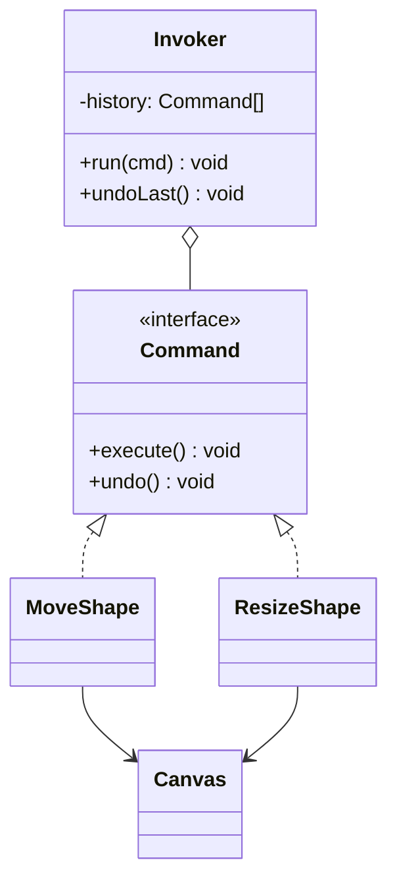

# Command

**Category:** Behavioral
**Also known as:** Action, Transaction, message, job
**Source:** https://refactoring.guru/design-patterns/command

## Intent

Turn a request into a value that holds the operation and all its arguments. Code can then store, queue, log, send, retry or reverse the request without knowing who will do the work.

## Signals in code

- The same operation starts from several places (HTTP route, CLI, cron, UI button) and each place repeats the argument assembly. Search for repeated calls such as `grep -rn "refundOrder(" <src-dir>`.
- A `switch` on an action name string runs the matching operation. Search: `grep -rnE "case ['\"](create|cancel|approve|archive)" <src-dir>`.
- Code needs undo or redo, and it stores ad hoc "before" values next to each mutation.
- Work must run later or elsewhere: a job queue, a retry table, an outbox, a scheduled task. Search: `grep -rnE "enqueue|addJob|schedule\(|outbox" <src-dir>`.
- An audit log must record who asked for what, with the exact arguments.
- UI components or controllers import domain services directly and call them with many arguments.

## Do not use when

- An operation runs once, right away, from one call site. Call the function.
- You only need to pass behavior as an argument. Pass a closure or a function reference.
- You need "undo" for a simple form. Keep the previous value in local state, or use a snapshot (see Memento).
- The framework already models the request: a route handler, a GraphQL mutation, a Redux action named as an imperative, a message type in your queue library. Use that type as the command. Do not wrap it again. The Redux style guide prefers event-style actions, which are Observer.
- You add a command bus with one handler per command and nothing else (no queue, no audit, no undo, no cross-cutting behavior). That is ceremony. Call the service method.

## Shape

- **Command**: data that names the operation and holds its arguments. It may also hold `execute` and `undo`.
- **Receiver**: the domain object or service that does the real work.
- **Invoker**: runs commands. It can queue them, retry them, record them in history, or apply middleware.
- **Client**: builds the command from user input and gives it to the invoker.



## Refactoring path

1. Choose one operation that has a concrete need: queueing, undo, audit or reuse from many entry points. Do not convert all operations at once.
2. Introduce Parameter Object. Put the arguments of that operation into a plain, serializable type, for example `{ type: "refund", orderId, amountCents }`.
3. Change each call site to build that object and pass it to one function. Tests stay green because the function calls the old code.
4. Stop point: a typed request object and a single handler already give audit logging and one place to add retries. Stop here if you need no queue or undo.
5. Add an invoker. It runs the handler and adds cross-cutting steps (logging, validation, transactions) in one place.
6. This changes behavior: callers lose the immediate result and error. Ask the user, and do it as its own commit. For deferred work, persist the command object instead of calling the handler. Make handlers idempotent. Include a command ID for deduplication.
7. For undo, add `undo()` or store a memento before `execute()`. Push executed commands onto a history stack. Clear the redo stack after a new command.
8. Use Replace Conditional with Polymorphism, or a handler map keyed by `type`, to remove the remaining `switch` on action names.

## Adaptations

- **Data plus handler map (recommended default):** a discriminated union of command types and a `Record<type, handler>`. Data is easy to serialize, log and test.
- **Closures:** `() => void` thunks are commands without names. Use them for local deferral. You cannot serialize or audit them.
- **TypeScript/JavaScript:** Redux actions when named as imperatives, `useReducer`, BullMQ or SQS job payloads. The Redux style guide prefers event-style actions, which are Observer. Discriminated unions give exhaustive checks with `never`.
- **Python:** dataclasses for commands, a dict of handlers. Celery and RQ tasks are commands with a transport.
- **Go:** a struct per command, and an interface with `Execute(ctx) error`. Use channels of commands for worker pools.
- **Java/C#/Kotlin:** records or sealed classes for commands. MediatR (requests) and Axon (`CommandGateway`) provide command buses. Use one only if you need its pipeline behaviors.
- **Rust:** an `enum` of commands and a `match` in the handler. The compiler checks every case.

## At architecture scale

- **CQRS:** commands change state, queries read it. Each command has one handler and one transaction boundary. Worth it when write rules are complex and read models differ from the write model. Not worth it for CRUD.
- **Job queues and task schedulers:** the command is the job payload. Design for at-least-once delivery, idempotency keys, versioned payload schemas and a dead-letter queue.
- **Transactional outbox:** write the command and the state change in the same transaction, then a relay sends it. Use it when a lost message costs money.
- **Undo across a document or design tool:** a command log with inverse operations, often merged with collaborative editing (operational transforms, CRDTs).
- **Remote procedure as message:** the command crosses a network boundary. Version the schema from day one.

## Trade-offs

**Gains:**
- One place for logging, retries, authorization and transactions.
- You can store, replay, schedule and send requests.
- Undo and redo get a clear structure.
- Senders and receivers change on their own.

**Costs:**
- A new layer and new types for each operation.
- Indirection makes "find the code that runs" harder. A handler map needs a naming rule.
- Persisted commands become a contract. Old payloads must still parse after deploys.
- Inverse operations can be hard or impossible (sent emails, external payments).

## Neighbors

- **Strategy**: a strategy is a way to do one job. A command is a job to do. Ask: will you store, queue or reverse this object?
- **Memento**: a memento stores state. A command stores intent. Ask: do you undo by replaying an inverse, or by restoring a saved state?
- **Chain of Responsibility**: the chain decides who handles a request. A command is the request. Ask: is the open question "what" or "who"?
- **Observer / domain event**: an event says something happened and has zero or more listeners. A command asks for something to happen and has one handler. Ask: past tense or imperative?

Often combined with: Memento (undo), Composite (macro commands), Chain of Responsibility (bus middleware), Prototype (copy commands into history).

## Minimal example

```typescript
interface Command {
  label: string
  execute(): void
  undo(): void
}

class Playlist {
  tracks: string[] = []
}

const addTrack = (list: Playlist, track: string): Command => ({
  label: `add ${track}`,
  execute: () => { list.tracks.push(track) },
  undo: () => { list.tracks.splice(list.tracks.lastIndexOf(track), 1) },
})

class UndoHistory {
  private done: Command[] = []
  private undone: Command[] = []

  run(cmd: Command) {
    cmd.execute()
    this.done.push(cmd)
    this.undone = []
  }
  undo() {
    const cmd = this.done.pop()
    if (cmd) { cmd.undo(); this.undone.push(cmd) }
  }
  redo() {
    const cmd = this.undone.pop()
    if (cmd) { cmd.execute(); this.done.push(cmd) }
  }
}
```
