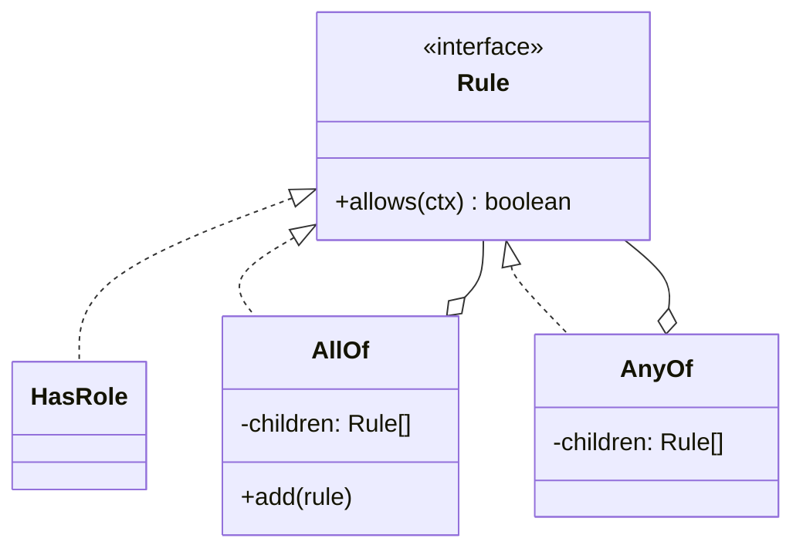

# Composite

**Category:** Structural
**Also known as:** Object Tree, Part-Whole Hierarchy
**Source:** https://refactoring.guru/design-patterns/composite

## Intent

Give single items and groups of items one shared interface, so clients can work on a whole tree as if it were one item. Each node handles a request itself or passes it to its children and combines the results.

## Signals in code

- Recursive functions that check node kind before they recurse. Search: `grep -rnE "(instanceof|\.type ===?) ?['\"]?(Group|Folder|Section|Node)"`.
- The same tree walk appears in several places, each with a different operation inside (total, render, validate).
- Code that handles "one item" and "list of items" in two branches, for example `Array.isArray(x) ? x.map(...) : f(x)`.
- Nested JSON or config with groups inside groups: menus, permission groups, rule sets, bill of materials, UI layouts.
- Fixed nesting depth hard-coded in loops (`for section ... for group ... for item`) where the domain allows any depth.
- Bugs where a new nesting level breaks a calculation.

## Do not use when

- The structure is flat or has a fixed depth of two. A list and a loop are enough.
- Leaves and groups share almost no operations. A forced common interface becomes vague and full of no-op methods. Use two separate types and a plain function over both.
- You only need to traverse a tree once, for example to serialize it. A recursive function over plain data is enough.
- The tree is a data structure with no behavior, such as a parsed JSON document. Use a discriminated union and a `switch` with exhaustive checks.
- Operations change much more often than node kinds. Visitor or plain functions over a union fit better.

## Shape

- **Component:** the shared interface for leaves and groups.
- **Leaf:** a node with no children. It does the real work.
- **Composite:** a node with children typed as Component. It delegates to them and combines results.
- **Client:** calls the Component interface and does not check node kinds.



## Refactoring path

1. Write tests for the current recursive function with trees of depth one, two and three.
2. List the operations that both leaves and groups need. Keep that list short.
3. Extract Interface: declare the Component with those operations only.
4. Make each leaf type implement the Component. Move its branch of the recursive function into it (Move Method).
5. Create the Composite class. Move the "for each child, recurse, combine" branch into it.
6. Replace Conditional with Polymorphism: delete the kind checks from the old function. It now calls `node.operation()`.
7. Decide where child management lives. Prefer `add`/`remove` on the Composite only. Put them on Component only if clients must build trees without knowing node kinds.
8. Build the tree in one place, such as a parser, a builder or a repository.

**Stop point:** after step 6 for one operation, the tree has a polymorphic core. Other operations can stay as functions until they need the same change.

## Adaptations

- **TypeScript/JavaScript (default for data-heavy trees):** a discriminated union plus one recursive function per operation. The compiler checks exhaustiveness. This is often lighter than classes.
- **TypeScript/JavaScript (default for behavior-heavy trees):** an interface with `allows`, `total` or `render`, and small classes or object literals for leaves and groups.
- **Functional languages:** an algebraic data type and a fold. A fold is the functional form of Composite.
- **Python:** a `Protocol` plus dataclasses. Use `functools.singledispatch` when you want operations outside the classes.
- **React and UI frameworks:** components that render children are Composite by default. Do not add a pattern layer on top.
- **Rust:** an `enum` with a `Vec<Node>` variant and `match`. Use a trait object only when third parties must add node kinds.

## At architecture scale

- **Aggregated health checks:** a service health endpoint combines the status of its dependencies, which combine their own.
- **Policy engines:** rule sets with `all`/`any`/`not` nodes, as in IAM policies or feature-flag targeting.
- **Organization and tenant hierarchies:** quotas, billing or settings that roll up from team to department to company.
- **Build and workflow graphs:** a pipeline stage that contains steps or other stages.
- **API composition:** a gateway that fans one request out to several services and merges the results. This is a composite of remote calls.

The architecture form is worth it when the hierarchy has real depth and users edit it at runtime. It is not worth it when the depth is fixed and known. Model fixed levels as named types instead.

## Trade-offs

**Gains:**
- Clients work with any depth through one call.
- New leaf or group kinds do not change client code.
- Recursion lives in the nodes, not in scattered walkers.

**Costs:**
- The shared interface can become too general.
- You cannot easily restrict which child kinds a group accepts at compile time.
- Deep trees cost stack depth and can hide slow fan-out, for example N database calls.

## Neighbors

- **Decorator**: Decorator wraps one child and adds behavior, while Composite holds many children and combines results. Ask: does the node have one wrapped object or a list of children?
- **Visitor**: Visitor moves operations out of the nodes. Ask: do new operations arrive more often than new node kinds?
- **Iterator**: Iterator gives a flat traversal of the tree. Ask: does the client need every node, or one combined answer?
- **Chain of Responsibility**: a leaf can pass a request up through its parents. Ask: does the request flow up the tree or down?
- **Flyweight**: shared immutable leaves can save memory in very large trees. Ask: do many leaves hold identical state?

Often combined with: Builder (build trees), Visitor (add operations), Iterator (traverse), Decorator (wrap one node).

## Minimal example

```ts
type Ctx = { roles: string[]; region: string };

interface Rule {
  allows(ctx: Ctx): boolean;
}

// Leaves.
const hasRole = (role: string): Rule => ({
  allows: (ctx) => ctx.roles.includes(role),
});
const inRegion = (region: string): Rule => ({
  allows: (ctx) => ctx.region === region,
});

// Composites: hold children of the same interface.
class AllOf implements Rule {
  constructor(private readonly children: Rule[]) {}
  allows(ctx: Ctx) { return this.children.every((r) => r.allows(ctx)); }
}
class AnyOf implements Rule {
  constructor(private readonly children: Rule[]) {}
  allows(ctx: Ctx) { return this.children.some((r) => r.allows(ctx)); }
}

// The client asks the root. Depth does not matter.
const canRefund: Rule = new AnyOf([
  hasRole("admin"),
  new AllOf([hasRole("support"), inRegion("eu")]),
]);

canRefund.allows({ roles: ["support"], region: "eu" }); // true
```
