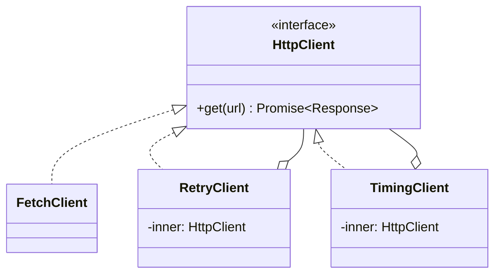

# Decorator

**Category:** Structural
**Also known as:** Wrapper
**Source:** https://refactoring.guru/design-patterns/decorator

## Intent

Add a responsibility to an object by wrapping it in another object with the same interface. The client stacks wrappers in any order and combination, and the wrapped object does not change.

## Signals in code

- The same cross-cutting lines repeat at the start and end of many methods: timing, logging, retry, metrics, auth checks. Search: `grep -rnE "performance\.now\(\)|console\.time|startSpan\(" src/ | wc -l`.
- Subclasses named after combined features, for example `CachedRetryingClient` or `LoggedEncryptedStore`.
- Boolean flags in a constructor that turn optional behaviors on and off, for example `new Client({ retry: true, log: true, cache: false })`, with `if (this.opts.retry)` inside methods.
- A class marked `final` or `sealed`, or a vendor class, that needs extra behavior.
- Copy-pasted `try/catch` blocks with backoff loops around different calls. Search: `grep -rn "for (let attempt" src/`.

## Do not use when

- The behavior applies to every request of a web app. Use the framework middleware or interceptor chain instead.
- You need to wrap one function, not an object with many methods. Use a higher-order function or a language decorator.
- There is one fixed combination of behaviors. Put the behavior in the class, or write one wrapper by hand.
- The interface has many methods and you want to change one. A full delegating wrapper costs a lot. Use a JavaScript `Proxy` or a mixin, or change the class.
- The order of wrappers changes results in ways that callers must know. Make the pipeline explicit instead, for example a list of steps.
- A wrapper must stop the call or choose another handler. That is Chain of Responsibility or Proxy.

## Shape

- **Component:** the interface that both the core object and the wrappers implement.
- **Concrete Component:** the core object with the base behavior.
- **Decorator:** holds a Component and delegates to it. A base decorator is optional in TypeScript.
- **Concrete Decorator:** adds behavior before or after the delegated call.
- **Client or composition root:** builds the stack of wrappers.



## Refactoring path

1. Find the repeated cross-cutting code. Confirm it does not depend on private state of the core object.
2. Extract Interface for the core object if it has none. Clients now depend on the interface.
3. Change construction to go through one factory or the composition root. Clients stop calling `new` on the core class.
4. Create one decorator class that implements the interface and delegates every method to an inner instance.
5. Move one cross-cutting concern from the core class into that decorator (Move Method). Run the tests.
6. Wrap the core object in the factory. The external behavior stays the same.
7. Repeat for each concern. Remove the related flags and `if` blocks from the core class.
8. Write a test that pins the wrapper order, for example "retry outside timing" or "timing outside retry".

**Stop point:** after step 6, one concern lives in a wrapper and the core class is smaller. Leave other concerns in place until they cause pain.

## Adaptations

- **TypeScript/JavaScript higher-order function (default for single functions):** `const withRetry = (fn) => async (...args) => { ... }`. Compose with `withTiming(withRetry(fetchUser))`. This is the lightest form.
- **TypeScript class wrapper (default for interfaces with two to five methods):** one class per concern, as in the example below.
- **TypeScript/ECMAScript decorators (`@logged`):** good for method-level concerns on classes you own. They apply at class definition, so the client cannot pick them per instance.
- **JavaScript `Proxy` object:** wraps all methods of an object at once with a trap. Use it for generic concerns such as tracing. It hides behavior from readers and from type tools.
- **Python `@decorator` syntax:** the default for function-level concerns: `@retry`, `@cache`, `@login_required`. Use `functools.wraps` to keep the name and docstring. Use a wrapper class only when the client must choose the stack at runtime.
- **Go:** wrapper structs that embed the interface, and `func(http.Handler) http.Handler` for HTTP.
- **Java/C#/Kotlin:** Kotlin `by` delegation removes the boilerplate. Spring AOP and .NET Scrutor decorate services through the container.
- **React:** custom hooks and wrapper components replaced most higher-order components. Prefer a hook.

Rule of thumb: use the language feature when the concern applies to one function and is fixed at definition time. Use object wrappers when the stack varies by configuration, tenant or environment.

## At architecture scale

- **HTTP middleware:** Express, Koa, ASP.NET and Go `net/http` handlers wrap the next handler. Each layer adds auth, logging, compression or rate limits.
- **HTTP client interceptors:** Axios interceptors, Angular `HttpInterceptor` and OkHttp interceptors decorate outgoing calls with tokens, retries and tracing.
- **gRPC interceptors and message-bus middleware:** the same idea on RPC and queue consumers.
- **Service mesh sidecars:** Envoy or Linkerd add mTLS, retries and metrics around a service without code changes. The sidecar decorates the network interface.
- **Stream wrappers:** gzip or encryption streams around a file or socket stream.

The architecture form is worth it when many services need the same concern with the same policy. It is not worth it for one service. In that case, use in-process middleware first.

## Trade-offs

**Gains:**
- Each concern lives in one small unit.
- Combinations happen at runtime with no new subclasses.
- The core object stays focused and testable.

**Costs:**
- Order matters and is easy to get wrong.
- Stack traces and debugging cross many layers.
- Full delegation is verbose for wide interfaces.
- Identity checks fail, because the wrapper is not the core object.

## Neighbors

- **Proxy**: Proxy controls access and often owns the lifecycle of the real object, while the client composes decorators. Ask: who decides that the wrapper exists, the client or the service owner?
- **Adapter**: Adapter changes the interface, while Decorator keeps it. Ask: does the wrapper expose the same methods as the inner object?
- **Chain of Responsibility**: a chain link can stop the request, while a decorator always delegates. Ask: can a layer decide not to call the next one?
- **Composite**: Composite has many children and combines results, while Decorator has one child. Ask: one inner object or many?
- **Strategy**: Strategy changes the core algorithm, while Decorator changes what happens around it. Ask: are you replacing the work or wrapping it?

Often combined with: Factory or composition root (build the stack), Composite (decorate one node), Proxy (a stack can contain both).

## Minimal example

```ts
interface HttpClient {
  get(url: string): Promise<Response>;
}

class FetchClient implements HttpClient {
  get(url: string) { return fetch(url); }
}

class RetryClient implements HttpClient {
  constructor(private inner: HttpClient, private attempts = 3) {}
  async get(url: string): Promise<Response> {
    for (let i = 1; ; i++) {
      try { return await this.inner.get(url); }
      catch (err) { if (i >= this.attempts) throw err; }
    }
  }
}

class TimingClient implements HttpClient {
  constructor(private inner: HttpClient, private report: (ms: number) => void) {}
  async get(url: string) {
    const start = performance.now();
    try { return await this.inner.get(url); }
    finally { this.report(performance.now() - start); }
  }
}

// Composition root: the stack is a runtime choice.
const client: HttpClient = new TimingClient(
  new RetryClient(new FetchClient(), 3),
  (ms) => console.log(`http.get ${ms.toFixed(0)}ms`),
);
```
