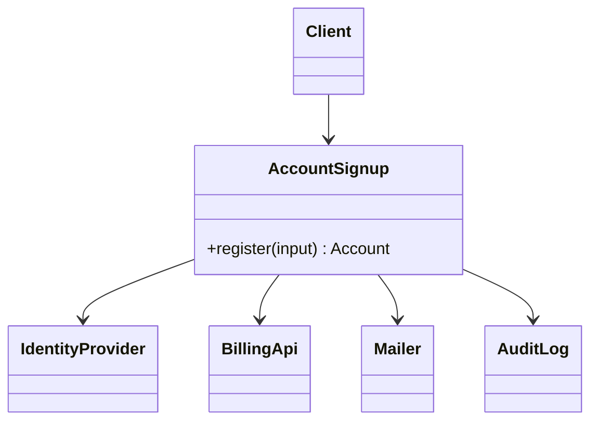

# Facade

**Category:** Structural
**Also known as:** none
**Source:** https://refactoring.guru/design-patterns/facade

## Intent

Give clients one small entry point to a subsystem with many parts, call orders and setup rules. The facade covers the common use cases, and the subsystem stays available for the rare ones.

## Signals in code

- Several controllers or jobs repeat the same sequence of calls to the same group of services. Search for the sequence: `grep -rn -A3 "createCustomer(" <src-dir> | grep "createSubscription("`.
- Business code imports many classes from one library or module to do one task. Search: `grep -rnE "^import \{[^}]{120,}\} from" <src-dir>`.
- Setup code with an order that matters, such as "init the client, then auth, then pick the region", copied into many files.
- A bug fix that needed edits in every place that runs the same workflow.
- New team members ask "which calls do I make, and in which order" for a common task.
- Tests for one use case need five or more mocks of the same subsystem.

## Do not use when

- The subsystem already has a simple API for your use case. A wrapper only renames calls.
- Only one place runs the workflow. Extract Function in that place instead.
- Clients need most of the subsystem features. A facade will grow to mirror the whole API.
- The real problem is an incompatible interface. Use Adapter.
- You plan to put new business rules in the facade. That makes it a service or a god object. Name and design it as a service.

## Shape

- **Facade:** a small set of task-level methods. It knows which subsystem parts to call and in which order.
- **Additional Facade:** a second facade for an unrelated group of tasks, so one facade does not grow without limit.
- **Subsystem classes:** do the real work. They do not know the facade exists.
- **Client:** calls the facade for common tasks. It may still call subsystem classes for rare tasks.



## Refactoring path

1. Find two or more call sites that run the same multi-step workflow. Diff them to find small variations.
2. Write an integration or contract test for the workflow at one call site.
3. Extract Function: move the sequence from that call site into a new module with a task-level name.
4. Turn the variations into parameters (Parameterize Method) or into two methods with clear names.
5. Replace the sequence at the other call sites with a call to the new function. Do one call site per commit. Add a characterization test at each call site before you replace it.
6. When the function needs shared setup or clients, promote it to a class with the dependencies injected.
7. Keep the facade free of new rules. Move any rule you find into the domain or the subsystem.
8. If the facade grows past about seven methods, split it by task area into additional facades.

**Stop point:** after step 5, the workflow lives in one place. A plain function is a complete and valid facade.

## Adaptations

- **TypeScript/JavaScript (default):** a module that exports a few task-level functions. Use a class only when you need injected dependencies or a lifecycle.
- **Python:** a module with functions is the natural facade. The package `__init__.py` that re-exports a small public API is also a facade.
- **Go:** a package with a small exported API over unexported internals. Package boundaries already give you most of the benefit.
- **Java/C#/Kotlin:** a service class registered in the DI container, with subsystem classes package-private or `internal`.
- **Frontend:** a custom hook or a store action that runs a multi-step flow, for example `useCheckout()`.
- **Library authors:** a small top-level API with an "advanced" namespace for full control.

## At architecture scale

- **API gateway:** one public entry point over many internal services, with routing, auth and rate limits. It is a facade at the network level.
- **Backend for frontend (BFF):** one facade per client type. It combines calls to several services into the shape that one screen needs.
- **Module public API in a modular monolith:** each module exposes one entry file. Other modules must not import internals. Enforce it with lint rules or tools such as `dependency-cruiser`.
- **Platform SDK or internal client library:** one package that hides service discovery, auth and retries.
- **Strangler fig entry point:** a module facade in front of a legacy subsystem. Callers move to the facade first. Then each facade method switches, one at a time, to the new implementation (see refactoring-playbook.md).
- **Orchestrating service:** a service that runs a workflow across several services. Treat it as a facade only if it holds no domain rules of its own.

The gateway or BFF is worth it when several clients call several services and the call patterns differ per client. It is not worth it for one client and one service. In that case, the gateway is an extra hop with no gain.

## Trade-offs

**Gains:**
- Clients depend on a few task-level calls, not on many classes.
- Changes to the subsystem stay inside the facade.
- Common workflows become easy to test and to reuse.

**Costs:**
- A facade can grow into a god object coupled to everything.
- It can hide features that some clients need, and they start to bypass it.
- A gateway or BFF adds a network hop, a deployable and an owner.
- A facade over remote services is not atomic. Decide what happens when step 2 of 4 fails: retry, compensate, or show a partial state.

## Neighbors

- **Adapter**: Adapter makes one object fit an interface that already exists, while Facade defines a new simple interface over many objects. Ask: is there a target interface that the wrapper must satisfy?
- **Mediator**: in Mediator, the components talk through the mediator, while subsystem classes ignore a facade. Ask: do the parts know about the central object?
- **Proxy**: Proxy has the same interface as one service, while Facade has its own. Ask: can the client swap the wrapper for the real object with no code change?
- **Abstract Factory**: it can replace a facade when you only want to hide object creation. Ask: is the complexity in creation or in use?

Often combined with: Adapter (facade over adapted vendors), Singleton or one container instance, Mediator.

## Minimal example

```ts
interface IdentityProvider { createUser(email: string): Promise<{ id: string }>; }
interface BillingApi { createCustomer(userId: string, plan: string): Promise<string>; }
interface Mailer { send(to: string, template: string, data: object): Promise<void>; }
interface AuditLog { record(event: string, data: object): void; }

export type SignupInput = { email: string; plan: "free" | "pro" };
export type Account = { userId: string; billingId: string };

// Facade: one task-level method. No new business rules inside.
export class AccountSignup {
  constructor(
    private ids: IdentityProvider,
    private billing: BillingApi,
    private mail: Mailer,
    private audit: AuditLog,
  ) {}

  async register({ email, plan }: SignupInput): Promise<Account> {
    const user = await this.ids.createUser(email);
    const billingId = await this.billing.createCustomer(user.id, plan);
    await this.mail.send(email, "welcome", { plan });
    this.audit.record("account.created", { userId: user.id, plan });
    return { userId: user.id, billingId };
  }
}

// Client code: one call instead of four, in the right order.
// const account = await signup.register({ email, plan: "pro" });
```
