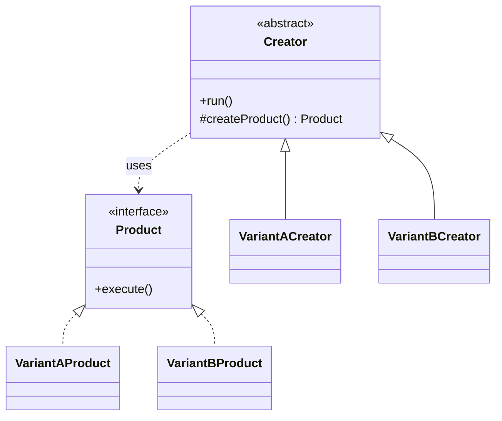

# Factory Method

**Category:** Creational
**Also known as:** Virtual Constructor
**Source:** https://refactoring.guru/design-patterns/factory-method

## Intent

Move the choice of which concrete class to instantiate out of the code that uses the object. A base type calls an overridable creation method, and each variant decides what that method returns.

## Signals in code

- A class runs one fixed workflow, but one collaborator inside it changes per variant. Search: `grep -nE "new (Csv|Json|Xml)[A-Z]\w*\("`.
- A `switch` on a type code that picks a class to instantiate, and is copied in two or more places. One such switch is acceptable (see smells-to-patterns.md).
- Subclasses exist only to swap one dependency, and they copy the parent method to change one `new` call.
- A framework or library class hard-codes `new DefaultThing()`, and users ask how to plug in their own `Thing`.
- Tests patch a module import or a global constructor because the class creates its dependency internally.

## Do not use when

- There is one product type and no second type is planned. Call the constructor directly.
- The caller already knows the concrete type. Pass the object in through the constructor (dependency injection).
- Variants differ only in data, not in behavior. Use a config object or a map from key to value.
- You need a creation hook but no class hierarchy exists. Pass a factory function (`() => Parser`) as a parameter.
- The only goal is to hide a `switch`. A plain function with a map lookup (`parsers[kind]()`) does this with less code.

## Shape

- **Product:** the interface that all created objects implement.
- **Concrete Product:** one implementation of Product.
- **Creator:** holds the main workflow and declares the factory method that returns a Product.
- **Concrete Creator:** overrides the factory method to return one Concrete Product.



## Refactoring path

1. Find every `new ConcreteProduct()` inside the creator class. Write characterization tests around the workflow if none exist.
2. Extract Interface from the concrete products. Change local variable types to that interface.
3. Extract Method: move each construction call into one `protected createProduct()` method. Tests stay green because behavior is the same.
4. If several types exist, add a temporary parameter or a `switch` inside `createProduct()`. Accept this ugly state for one commit.
5. Replace Conditional with Polymorphism: create one subclass per branch and override `createProduct()` in each.
6. Remove the `switch`. Make the base method abstract, or keep one branch as the default.
7. Move the choice of creator to one place. If the variant is fixed per deployment or per caller, choose at the composition root. If it comes from runtime data (per file, per request), keep one map from type code to creator or factory function.

**Stop point:** after step 3 the creation logic lives in one method. This already gives a test seam. Many teams stop here and inject a factory function instead of subclassing.

## Adaptations

- **Default for TypeScript/JavaScript and Python:** pass a factory function or a class reference as a constructor parameter. Example: a `StatementImport` variant whose constructor takes `makeParser: () => StatementParser`. This keeps the intent with no subclass.
- **Functional style:** a higher-order function that takes `makeProduct` and returns the workflow function.
- **Go:** accept a `func() Product` field in the struct, or accept the interface value directly. Go has no inheritance, so the subclass form does not apply.
- **Rust:** take a generic `F: Fn() -> Box<dyn Product>` or a trait with an associated constructor.
- **Java/C#/Kotlin:** the classic subclass form is idiomatic in frameworks. In application code, prefer constructor injection with a `Supplier<T>` or `Func<T>`.
- **DI containers:** a factory provider (`useFactory` in NestJS, `@Provides` in Dagger) is the factory-function form, managed by the container.
- **React:** a `render` prop or a component prop (`ItemComponent={Row}`) lets the parent decide which component to create.

## At architecture scale

- A plugin host loads extensions through a registration function. Each plugin supplies the factory for its own handlers.
- A service selects an adapter per tenant or per region at startup. One function per adapter type builds the adapter.
- Worth it when third parties or other teams add variants without editing the host. Not worth it for one internal variant with no planned growth.

## Trade-offs

**Gains:**
- The workflow code does not depend on concrete product classes.
- New variants are additions, not edits to the existing workflow.
- One creation seam for tests.

**Costs:**
- One subclass per variant can grow into a large parallel hierarchy.
- Inheritance couples the creator subclass to the base workflow.
- Readers must jump between files to see which object is created.

## Neighbors

- **Abstract Factory**: creates a family of related products through several methods, not one product. Ask: must two or more created objects match each other?
- **Simple factory function**: a static function with a `switch` that returns a product, with no subclassing. Ask: does the variant choice need to be extensible by other code?
- **Template Method**: Factory Method is a Template Method whose varying step is object creation. Ask: does the varying step create an object or run an algorithm?
- **Prototype**: creates by copying a configured instance, with no subclass per variant. Ask: do variants differ in configuration only?

Often combined with: Template Method, Abstract Factory, Iterator.

## Minimal example

```ts
type Entry = { date: string; amountCents: number };

interface StatementParser {
  parse(raw: string): Entry[];
}

class JsonParser implements StatementParser {
  parse(raw: string): Entry[] { return JSON.parse(raw); }
}

class CsvParser implements StatementParser {
  parse(raw: string): Entry[] {
    return raw.trim().split("\n").slice(1).map((line) => {
      const [date, amount] = line.split(",");
      return { date, amountCents: Math.round(Number(amount) * 100) };
    });
  }
}

abstract class StatementImport {
  protected abstract createParser(): StatementParser;

  total(raw: string): number {
    const entries = this.createParser().parse(raw);
    return entries.reduce((sum, e) => sum + e.amountCents, 0);
  }
}

class JsonImport extends StatementImport {
  protected createParser() { return new JsonParser(); }
}
class CsvImport extends StatementImport {
  protected createParser() { return new CsvParser(); }
}
```
