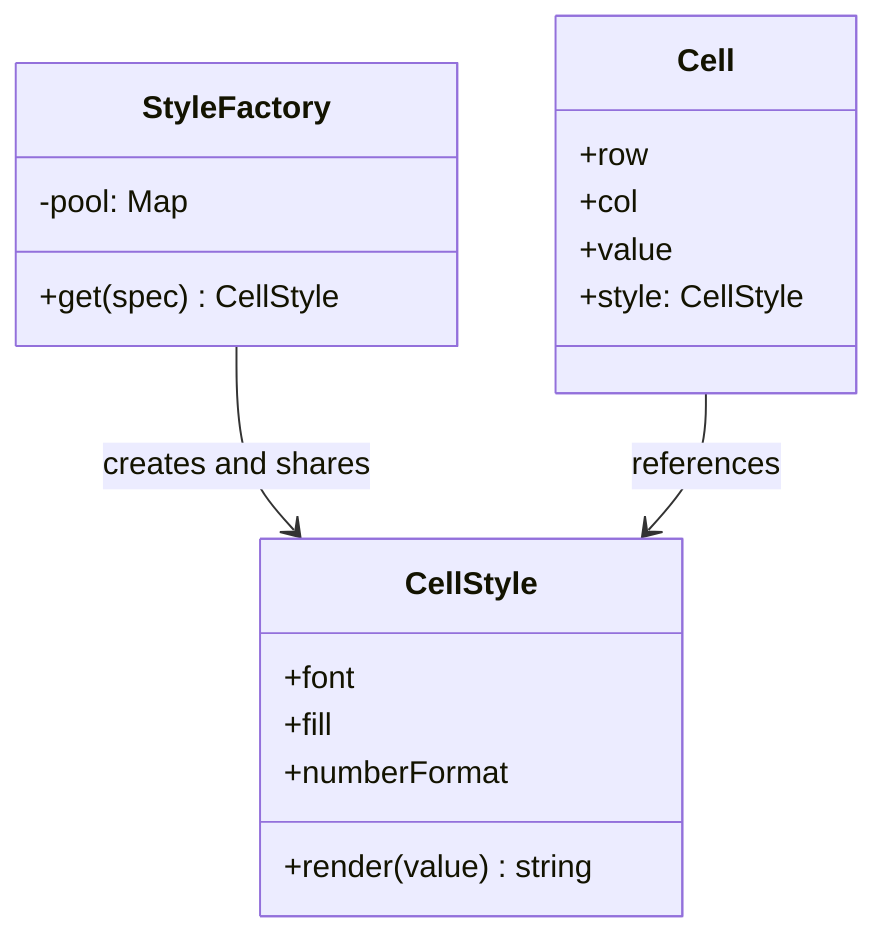

# Flyweight

**Category:** Structural
**Also known as:** none (Refactoring Guru lists "Cache", but caching is a different idea, see Neighbors)
**Source:** https://refactoring.guru/design-patterns/flyweight

## Intent

Cut memory use when a program holds many similar objects. Store the heavy, repeated, immutable part once and share it, and keep only the small per-object part in each instance.

## Signals in code

- A heap snapshot or memory profile shows millions of instances of one class, with the same values in most fields.
- Objects that copy the same large data, for example a style, a schema, a texture, a font or a price table, into each instance.
- Loops that create a new object per row, cell, particle or event with mostly constant fields. Search: `grep -rnE "new (Style|Font|Format|Schema)\(" <src-dir>`.
- Out-of-memory crashes or long GC pauses that grow with input size, while the number of distinct values stays small.
- Large exports or imports (spreadsheets, logs, map data) that hold the whole dataset in memory as rich objects.

## Do not use when

- No profiler shows a memory problem. Flyweight is an optimization, not a design goal. Measure first.
- Object count times intrinsic bytes is small next to the heap. Compute it before you refactor.
- The shared part must change per object. Shared mutable state causes bugs that are hard to find. Keep one object per item.
- Streaming solves it. Process records one at a time instead of holding them all in memory.
- A columnar layout or typed arrays solve it better. Store fields as arrays of numbers instead of objects.
- The runtime already interns the values, for example short strings in many engines or enum values.

## Shape

- **Flyweight:** holds the intrinsic state, which is shared and immutable. Methods take the extrinsic state as parameters.
- **Flyweight Factory:** returns an existing flyweight for a key, or creates and stores a new one.
- **Context:** holds the extrinsic state, which is unique per object, plus a reference to one flyweight.
- **Client:** creates contexts and asks the factory for flyweights.



## Refactoring path

1. Measure. Record heap size and object count for a realistic input. Set a target number.
2. Split the class fields into two lists: intrinsic (repeated, never changes per object) and extrinsic (unique or changing).
3. Make the intrinsic fields read-only. Set them only in the constructor. Freeze the object if the language allows it.
4. Extract Class: move the intrinsic fields and the methods that use only them into a new flyweight class.
5. Move the methods that also read extrinsic fields, and pass those fields as parameters (Move Method plus Add Parameter).
6. Create the factory with a map keyed by a stable serialization of the intrinsic state.
7. Change the creation sites to call the factory. Keep the extrinsic fields in the original class, which becomes the context.
8. Measure again with the same input. Keep the change only if it meets the target.

**Stop point:** steps 4, 6 and 7 without step 5. Skip step 5 when the shared methods do not need extrinsic state. This gives most of the saving without changing method signatures.

## Adaptations

- **TypeScript/JavaScript (default):** a `Map<string, Readonly<T>>` cache plus `Object.freeze`. Keep the context as a plain object with a reference to the shared value. No classes are needed.
- **Typed arrays and struct-of-arrays:** store the per-object numbers in `Float32Array` or `Int32Array` columns and the shared data in a small lookup table by index. This often saves more than Flyweight does.
- **Python:** `__slots__` on the context class, `sys.intern` for repeated strings, and `functools.cache` on a factory function. Do not use `lru_cache` there, because eviction breaks identity. `enum` members are flyweights already.
- **Java/C#:** `String.intern`, `Integer.valueOf` caching and `record` types for immutable shared values.
- **Rust:** `Rc<T>` or `Arc<T>` for shared immutable data, or an index into a `Vec` arena.
- **Game and simulation code:** an entity-component system stores component data in dense arrays. Use it instead of per-object flyweights.

## At architecture scale

- **Dictionary encoding in columnar formats:** Parquet and Arrow store each distinct value once and keep small integer codes per row.
- **Normalized reference data:** a database stores a country or product once and rows hold a foreign key. Denormalized copies trade this saving for read speed.
- **Content-addressable storage:** container image layers, Git objects and deduplicating backups store identical blocks once and share them by hash.
- **Shared read-only caches:** one in-process cache of config or catalog data, shared by all requests, instead of one copy per request.

Note: object pools and connection pools are a different idea. A pool lends a mutable object to one user at a time. A flyweight is shared by many users at the same time and never changes.

The architecture form is worth it when storage or memory cost is a measured problem at scale. It is not worth it as a default. Normalization and deduplication add reads, joins and cache invalidation work.

## Trade-offs

**Gains:**
- Large memory savings when the distinct intrinsic values are few and the objects are many.
- Fewer allocations and less GC pressure.
- Equality checks on shared parts can use reference identity.

**Costs:**
- The object state splits across two places, which confuses readers.
- Callers must pass extrinsic state into each call.
- The factory lookup costs CPU, and the pool can leak memory if it never evicts.
- A mutation of a shared object corrupts every context that uses it.

## Neighbors

- **Singleton**: a Singleton has one instance and can be mutable, while flyweights have many instances, one per intrinsic value, and are immutable. Ask: is there exactly one, or one per distinct value?
- **Prototype**: Prototype copies an object, while Flyweight shares it. Ask: does each user need its own copy?
- **Composite**: shared leaves in a large tree can be flyweights. Ask: do many leaves hold the same state?
- **Proxy (caching)**: a caching proxy stores results per request, while a flyweight factory stores shared state objects. Ask: are you caching answers or caching the objects themselves?

Often combined with: a factory function or registry (the flyweight factory), Composite (shared leaves), State or Strategy objects without fields (share one instance).

## Minimal example

```ts
type StyleSpec = { font: string; bold: boolean; numberFormat: "int" | "money" };

// Flyweight: shared, immutable, takes extrinsic state as a parameter.
class CellStyle {
  readonly spec: Readonly<StyleSpec>;
  constructor(spec: StyleSpec) { this.spec = Object.freeze({ ...spec }); Object.freeze(this); }
  render(value: number): string {
    const text = this.spec.numberFormat === "money" ? value.toFixed(2) : String(Math.round(value));
    return this.spec.bold ? `**${text}**` : text;
  }
}

// Factory: one instance per distinct spec.
class StyleFactory {
  private pool = new Map<string, CellStyle>();
  get(spec: StyleSpec): CellStyle {
    const key = `${spec.font}|${spec.bold}|${spec.numberFormat}`;
    let style = this.pool.get(key);
    if (!style) this.pool.set(key, (style = new CellStyle(spec)));
    return style;
  }
  get size() { return this.pool.size; }
}

// Context: small, unique per cell, references a shared style.
type Cell = { row: number; col: number; value: number; style: CellStyle };

const styles = new StyleFactory();
const cells: Cell[] = [];
for (let row = 0; row < 1_000_000; row++) {
  const style = styles.get({ font: "Inter", bold: row === 0, numberFormat: "money" });
  cells.push({ row, col: 0, value: row * 1.5, style });
}
console.log(styles.size); // 2 styles shared by 1,000,000 cells
```
