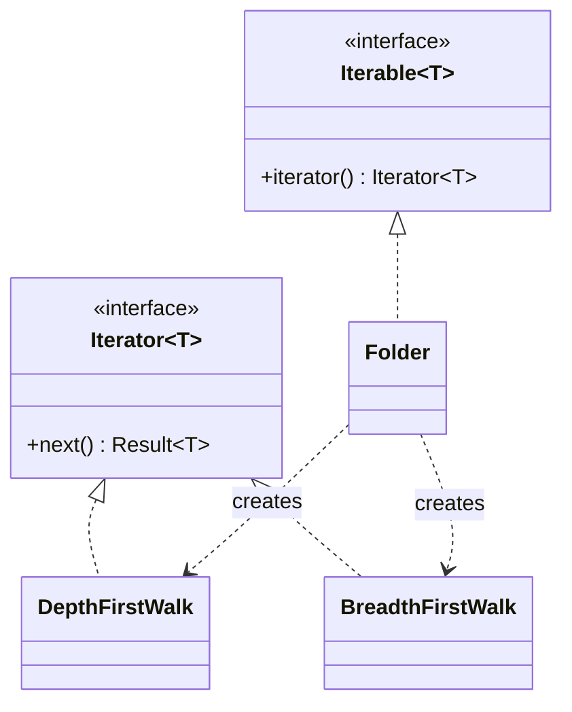

# Iterator

**Category:** Behavioral
**Also known as:** Cursor, enumerator, generator
**Source:** https://refactoring.guru/design-patterns/iterator

## Intent

Give callers a uniform way to walk through the elements of a structure, one at a time, without knowing how the structure stores them. The traversal state lives outside the structure, so several walks can run at the same time.

## Signals in code

- Callers read internal fields of a container to loop over it, for example `tree.root.children[i].children`. Search: `grep -rnE "\.(children|nodes|items|_data)\[" <src-dir>`.
- The same traversal (depth-first, paged API fetch, cursor over a result set) appears as a copy in several functions. Search: `grep -rnE "while \(.*(nextPage|cursor|hasMore|stack\.length)" <src-dir>`.
- A function loads a full dataset into an array only to loop over it once, and memory grows with input size.
- Paging logic (`offset`, `limit`, `nextToken`) and business logic share the same loop.
- A class exposes `getItems(): T[]` and callers mutate the returned array.
- Two consumers need different orders over the same data (by priority, by insertion, breadth-first).

## Do not use when

- The data is an array, list, map or set and a normal loop works. The language already gives you an iterator. Use `for...of`, `forEach`, comprehensions or `range`.
- Do not write a class with `hasNext()` and `next()` in a language with generators. Write a generator (`function*`, `yield`) or, in Go, a range-over-func `iter.Seq`.
- The caller needs random access or the length up front. Return an array or a read-only view.
- The dataset is small and bounded. Materialize it into an array and keep the code simple.
- You need set operations or joins across sources. Use the database or a query library, not hand-made iterators.

## Shape

- **Iterator**: holds traversal position and returns the next element or a "done" signal.
- **Iterable / aggregate**: the structure. It creates a fresh iterator on request.
- **Client**: consumes elements through the iterator protocol only.
- **Traversal variants**: several iterators over one structure, one per order or filter.



## Refactoring path

1. Find every loop that reaches into the container internals. Add tests that record the order of elements each loop sees.
2. Extract Method. Move one traversal into a function on the container or in its module.
3. Turn that function into a generator that yields elements. Keep the name explicit, for example `walkDepthFirst()`.
4. Replace the copied loops in callers with `for...of` over the generator. Tests must show the same order.
5. Stop point: a generator per traversal already hides the structure. Most codebases stop here.
6. Make the container itself iterable (`[Symbol.iterator]`, `__iter__`) only when one order is the obvious default.
7. Encapsulate Collection. First give the container methods for each mutation that callers do (push, splice, sort, index assignment), and move those callers to them. Then replace the getters that return the internal array with the iterator or a read-only copy.
8. For remote or paged data, use an async generator. Fetch the next page only when the consumer asks for more.

## Adaptations

- **Generators (recommended default):** almost every modern language has them. A generator keeps position in its local variables, so you need no class.
- **TypeScript/JavaScript:** `function*` for sync data, `async function*` with `for await...of` for pages and streams. Implement `[Symbol.iterator]` to make a class work with spread and `for...of`. Prefer `Iterator.prototype.map` and `filter` helpers where your runtime supports them.
- **Python:** generator functions, `__iter__`, and `itertools` for chaining, slicing and grouping. Database drivers already return cursors.
- **Go:** `iter.Seq[T]` and `iter.Seq2[K, V]` with range-over-func (Go 1.23+). Before that, use a callback or a channel only when a goroutine is already needed.
- **Rust:** implement `Iterator` with `next()`. Adapters (`map`, `filter`, `take`) are lazy and zero cost.
- **Java/C#/Kotlin:** `Iterable` and `Stream` in Java, `IEnumerable` with `yield return` in C#, `sequence { yield(x) }` in Kotlin.
- **ORMs and SDKs:** many already offer paginators or streaming cursors. Use those before you write one.

## At architecture scale

- **Cursor-based pagination in APIs:** the server returns an opaque cursor, not an offset. Clients cannot depend on storage order or primary keys. Use it when data changes during paging.
- **Streams and change feeds:** Kafka consumers, database change streams and S3 list operations are iterators with persisted positions (offsets, tokens).
- **Batch jobs:** a job walks a large table in chunks with a saved checkpoint. Save the cursor so the job can resume after a crash. This combines Iterator with Memento.
- Worth it when datasets do not fit in memory, or when the producer and the consumer change at different speeds.
- Not worth it for small internal lists. A plain array response is easier to cache and debug.

## Trade-offs

**Gains:**
- Callers do not depend on storage layout.
- Lazy evaluation keeps memory flat on large data.
- Several independent traversals over the same data.
- You add new orders without changes to callers.

**Costs:**
- Lazy code runs later than it looks. Errors and side effects move to the consumer loop.
- A single-pass iterator surprises callers who loop twice.
- Changes to the structure during a walk give undefined or wrong results unless you guard them.
- Small overhead against direct index access in hot loops.

## Neighbors

- **Visitor**: an iterator chooses the order of elements. A visitor chooses the operation per element type. Ask: is the variation in the walk or in the work?
- **Composite**: a composite is the tree. An iterator walks it. Ask: do callers need to know about nesting at all?
- **Memento**: a memento can save an iterator position. Ask: must the walk resume after a restart?
- **Observer / streams**: an iterator is pull-based. A stream or observable pushes to subscribers. Ask: does the consumer or the producer control the pace?

Often combined with: Composite, Factory Method (the container chooses which iterator to return), Memento (resume points).

## Minimal example

```typescript
type Page<T> = { items: T[]; next?: string }
type FetchPage<T> = (cursor?: string) => Promise<Page<T>>

async function* allItems<T>(fetchPage: FetchPage<T>): AsyncGenerator<T> {
  let cursor: string | undefined
  do {
    const page = await fetchPage(cursor)
    yield* page.items
    cursor = page.next
  } while (cursor)
}

class OrgChart {
  constructor(private reports: Map<string, string[]>, private root: string) {}

  *breadthFirst(): Generator<string> {
    const queue = [this.root]
    for (let i = 0; i < queue.length; i++) {
      const person = queue[i] // index pointer: shift() is O(n) per call
      yield person
      queue.push(...(this.reports.get(person) ?? []))
    }
  }
}

// Callers never see the map or the page token.
async function countInactive(fetch: FetchPage<{ active: boolean }>) {
  let n = 0
  for await (const user of allItems(fetch)) if (!user.active) n++
  return n
}
```
