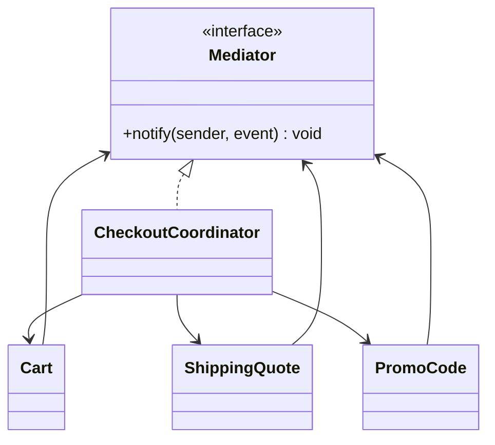

# Mediator

**Category:** Behavioral
**Also known as:** Intermediary, Controller, coordinator, orchestrator
**Source:** https://refactoring.guru/design-patterns/mediator

## Intent

Stop a group of peer objects from calling each other directly, and route their interactions through one coordinating object. The peers stay simple and reusable, and the rules about how they react to each other live in one place.

## Signals in code

- Several classes hold references to each other in a mesh. A change in one forces edits in three others. Search for mutual imports, for example with `madge --circular` or `grep -rn "import .* from './"` per module.
- A component calls methods on siblings after an event: "when the cart changes, update the shipping widget, the promo banner and the total".
- You cannot reuse a component in a second screen or workflow because it calls specific neighbors.
- Subclasses exist only to change which siblings a component talks to.
- Workflow steps call the next step directly, so a change in order requires edits in several services.
- In React or Vue, many sibling components pass callbacks through props to update each other.

## Do not use when

- Only two objects interact. A direct call is clearer.
- The interactions are one-way notifications with no rules that span peers. Use Observer or a plain event emitter.
- The goal is a simple entry point into a subsystem. That is a Facade.
- The peers already share a state store (Redux, Zustand, a signal store). The store and its derived state are the mediator. Do not add another one.
- The coordination logic is one `if`. Put it in the parent component or the calling function.
- A mediator already exists and grows every sprint. Split it by use case before you add more rules to it.

## Shape

- **Mediator**: the contract that peers use to report events, usually one `notify(sender, event)` method or typed methods.
- **Concrete mediator**: knows the peers and holds the rules for how one event triggers actions on others.
- **Colleague / component**: does its own job and reports events to the mediator. It never calls other colleagues.



## Refactoring path

1. Draw the current call graph between the peers. List each "when X happens, do Y on Z" rule.
2. Add tests at the group level that trigger each event and assert the effects on the other peers.
3. Create the mediator as a plain object or function that the parent (screen, service, workflow runner) owns.
4. Move one rule at a time. Replace the direct sibling call with a call to the mediator. Use Move Method to put the rule in the mediator.
5. Stop point: after the most tangled rules move, the remaining direct calls may be fine. Stop if you can now reuse the peers.
6. Remove sibling references from each peer. Inject the mediator instead, through the constructor or a callback.
7. Extract Interface for the mediator only when one peer must work under two different mediators.
8. Watch the mediator size. When it exceeds one use case, split it per workflow or per screen.

## Adaptations

- **Parent owns the rules (recommended default for UI):** in React, Vue or Svelte, lift state to the closest common parent, or use a store. Children get values and emit events through callbacks.
- **Typed event channel:** an event emitter with a typed event map. The mediator subscribes and reacts. This mixes Mediator with Observer and is common in TS/JS.
- **Python:** a coordinator function or class that peers call. Django signals or `blinker` give the channel, but keep the rules in one module.
- **Go:** a coordinator struct with methods, or a goroutine that reads events from a channel and calls peers.
- **Java/C#/Kotlin:** MediatR (C#) or Spring events give the plumbing. Keep one handler class per use case so rules stay in one place.
- **Functional:** a reducer is a mediator for state. Events go in, the new state comes out, and views read derived values.

## At architecture scale

- **Orchestration (saga orchestrator, workflow engine):** one service tells the others what to do and tracks progress. Temporal, AWS Step Functions and Camunda are mediators for services. Use orchestration when the flow has many steps, compensations, and a need to see status in one place.
- **Choreography (event bus):** services react to events and nobody owns the flow. This is closer to Observer. Use it when steps are independent and teams deploy on their own.
- **Message broker as mediator:** the broker removes direct addresses between services, but it does not hold business rules. Do not confuse transport with coordination.
- **Backend for frontend:** a BFF can coordinate calls to several services for one screen.
- Not worth it for two services with one call between them. A direct API call with a timeout and retry is enough.
- Risk: an orchestrator that contains domain rules of every service becomes a distributed god object.

## Trade-offs

**Gains:**
- Peers become independent and reusable.
- Interaction rules are in one place and easy to test.
- New interaction rules do not touch the peers.

**Costs:**
- The mediator can grow into a god object.
- Indirection hides who reacts to what. Tracing an effect needs a look at the mediator.
- A single coordinator is a single point of failure at service scale.

## Neighbors

- **Observer**: Observer lets any number of listeners subscribe, and the publisher has no rules about them. Ask: is there one place that decides what happens next?
- **Facade**: a facade simplifies access to a subsystem, and the subsystem does not know about it. Ask: do the parts call the coordinator, or does only the outside caller?
- **Chain of Responsibility**: the chain passes a request along a line. A mediator fans out by rules. Ask: is the flow linear or a graph?
- **Command**: commands are the messages. A mediator decides who gets them. Ask: is the question the content of the message or its route?

Often combined with: Observer (event channel), Command (typed messages), State (the mediator tracks workflow state).

## Minimal example

```typescript
type CheckoutEvent =
  | { type: "cartChanged"; subtotalCents: number }
  | { type: "promoApplied"; percentOff: number }

interface Coordinator { notify(e: CheckoutEvent): void }

class ShippingQuote {
  cents = 0
  recalc(subtotal: number) { this.cents = subtotal >= 5000 ? 0 : 799 }
}

class Summary { render(total: number) { console.log(`total ${total / 100}`) } }

class CheckoutCoordinator implements Coordinator {
  private subtotal = 0
  private discount = 0
  constructor(private shipping: ShippingQuote, private summary: Summary) {}

  notify(e: CheckoutEvent) {
    if (e.type === "cartChanged") {
      this.subtotal = e.subtotalCents
      this.shipping.recalc(this.subtotal)
    }
    if (e.type === "promoApplied") this.discount = e.percentOff
    const goods = this.subtotal * (1 - this.discount / 100)
    this.summary.render(goods + this.shipping.cents)
  }
}

// The cart only reports. It knows nothing about shipping or the summary.
class Cart {
  constructor(private hub: Coordinator) {}
  setSubtotal(cents: number) { this.hub.notify({ type: "cartChanged", subtotalCents: cents }) }
}

class PromoCode {
  constructor(private hub: Coordinator) {}
  apply(percentOff: number) { this.hub.notify({ type: "promoApplied", percentOff }) }
}
```
