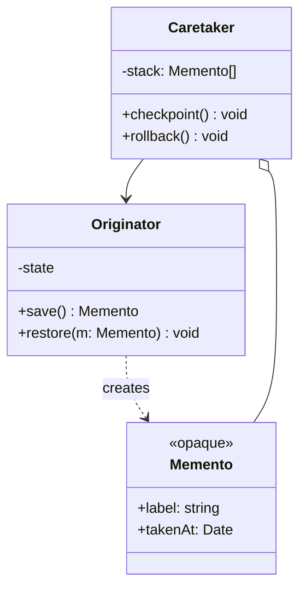

# Memento

**Category:** Behavioral
**Also known as:** Snapshot, checkpoint, token
**Source:** https://refactoring.guru/design-patterns/memento

## Intent

Let an object export an opaque copy of its own state and later restore itself from that copy. Other code can store and pass the copy around but cannot read or change what is inside it.

## Signals in code

- Code outside a class copies its fields one by one to save them, then writes them back to undo. Search: `grep -rnE "(prev|old|backup|saved)[A-Z]\w* = .*\.\w+"`.
- Fields are public, or have setters, only so that an undo or reset feature can restore them.
- A `try` block changes several fields and the `catch` block reverts them by hand.
- Undo, "discard changes" or "reset to saved" logic appears as a copy in several screens.
- Optimistic UI updates have hand-written rollback code per mutation.
- A long job restarts from zero after a crash because it does not save progress.

## Do not use when

- The state is already immutable data (a Redux store, a record, a frozen object). Keep a reference to the old value. That reference is the snapshot.
- The state is small and public by design (a form value). Save `structuredClone(value)` or a shallow copy.
- The database can roll back for you. Use a transaction or a savepoint.
- Snapshots are large and frequent. Store the inverse operations (Command undo) or diffs instead.
- The object holds live resources (sockets, file handles, timers). A snapshot cannot capture them. Recreate them on restore, or do not snapshot that object.
- You need an audit of every change, not only restore points. Use an event log (see "At architecture scale").

## Shape

- **Originator**: the object that owns the state. It creates a memento and restores from one.
- **Memento**: an immutable, opaque value with the saved state and optional metadata (time, label).
- **Caretaker**: decides when to save and when to restore. It stores mementos but never reads their content.



## Refactoring path

1. Find code that reads and writes another object's fields to save or revert them. Add tests that change state and assert a full revert.
2. Move Method. Put a `save()` method on the owner that returns a copy of its state as one value.
3. Add `restore(snapshot)` on the owner. Replace the external field-by-field revert with this call.
4. Stop point: a `save`/`restore` pair with a plain copy already fixes the encapsulation leak. Many codebases need no more.
5. Make the snapshot opaque. Keep its state in a closure, in `#private` fields, or in a private class. A branded type alone gives nominal typing but does not hide fields.
6. Remove the setters and public fields that existed only for the old undo logic.
7. Add a caretaker (history stack, checkpoint store) when more than one caller needs the restore points.
8. Bound the history. Set a maximum depth or memory budget and drop the oldest snapshots.

## Adaptations

- **Immutable state plus references (recommended default for TS/JS UI):** if updates create new objects, the previous object is the memento. Keep an array of past states. Immer patches give cheap diffs.
- **Closure as memento:** `save()` returns `() => void` that restores the captured state. The caller cannot read the state, so encapsulation holds without a class.
- **TypeScript:** use a branded type for nominal typing, and keep the state inside the originator (a `#private` WeakMap keyed by the snapshot) or in a closure. A brand alone does not hide fields. `structuredClone` gives a deep copy of plain data.
- **Optimistic UI:** save the cache entry before the mutation and restore it on error. TanStack Query (`onMutate` returns context, `onError` restores) and Apollo optimistic responses are built-in forms.
- **Python:** `copy.deepcopy` or a frozen dataclass. Use `__getstate__` and `__setstate__` to control what the snapshot holds.
- **Go:** an exported type with unexported fields (`type Snapshot struct{ seats []string }`). Other packages can store it in fields and slices but cannot read or build its content.
- **Rust:** `#[derive(Clone)]` on the state struct and a private field in a newtype for opacity.
- **Java/C#/Kotlin:** a public marker interface `Memento` (metadata only) implemented by a private nested class of the originator. A public record is not opaque, because its accessors are public. Kotlin `data class` with `copy()` gives cheap snapshots.

## At architecture scale

- **Event sourcing with snapshots:** the event log is the full history. Periodic snapshots are mementos that make rebuild fast. Worth it when you need audit and time travel. Not worth it for simple CRUD.
- **Checkpoints in batch and stream jobs:** Flink, Spark and Kafka consumer offsets save progress. A crashed job restarts from the last checkpoint.
- **Saga compensation:** each step records the data its compensating action needs. That is Command-style undo (an inverse), not a state restore. See Command.
- **Infrastructure snapshots:** database backups, volume snapshots and VM images. Same idea, at a different scale and cost.
- **Session and draft storage:** save a serialized memento of a wizard or editor so the user resumes on another device. Version the format.
- Caution: a serialized memento is a contract. Old snapshots must still load after a schema change. Add a version field and a migration.

## Trade-offs

**Gains:**
- Undo, rollback and resume without breaking encapsulation.
- The owner controls what it saves and how it restores.
- Caretakers stay generic and simple.

**Costs:**
- Memory use grows with snapshot size and frequency.
- Deep copies are slow for large graphs, and shallow copies share mutable parts by accident.
- Caretakers must drop old snapshots, or memory leaks.
- In JS, opacity needs closures or `#private` fields. In Python, it is always a convention.
- Persisted snapshots need versioning and migration.

## Neighbors

- **Command**: a command can undo by an inverse operation. A memento undoes by state restore. Ask: is the inverse cheaper to write than the snapshot is to store?
- **Prototype**: a clone of the whole object can serve as a snapshot when the object is simple. Ask: must you block callers from reading the saved state?
- **Iterator**: a memento can save a traversal position. Ask: must the walk resume after a restart?
- **State**: State changes behavior by state. Memento saves and restores data. Ask: do you switch modes, or go back in time?

Often combined with: Command (undo stacks), Iterator (resumable cursors), Prototype (cheap copies).

## Minimal example

```typescript
declare const brand: unique symbol
type Snapshot = { readonly [brand]: true; readonly label: string }

class SeatMap {
  #held = new Set<string>()
  #snapshots = new WeakMap<Snapshot, string[]>()

  hold(seat: string) {
    if (this.#held.has(seat)) throw new Error(`${seat} taken`)
    this.#held.add(seat)
  }

  save(label: string): Snapshot {
    const snap = { label } as Snapshot
    this.#snapshots.set(snap, [...this.#held])
    return snap
  }

  restore(snap: Snapshot) {
    const seats = this.#snapshots.get(snap)
    if (!seats) throw new Error("foreign snapshot")
    this.#held = new Set(seats)
  }
}

// Caretaker: holds a snapshot, never reads it.
function holdGroup(map: SeatMap, seats: string[]) {
  const before = map.save("before group hold")
  try {
    seats.forEach((s) => map.hold(s))
  } catch (err) {
    map.restore(before)
    throw err
  }
}
```
