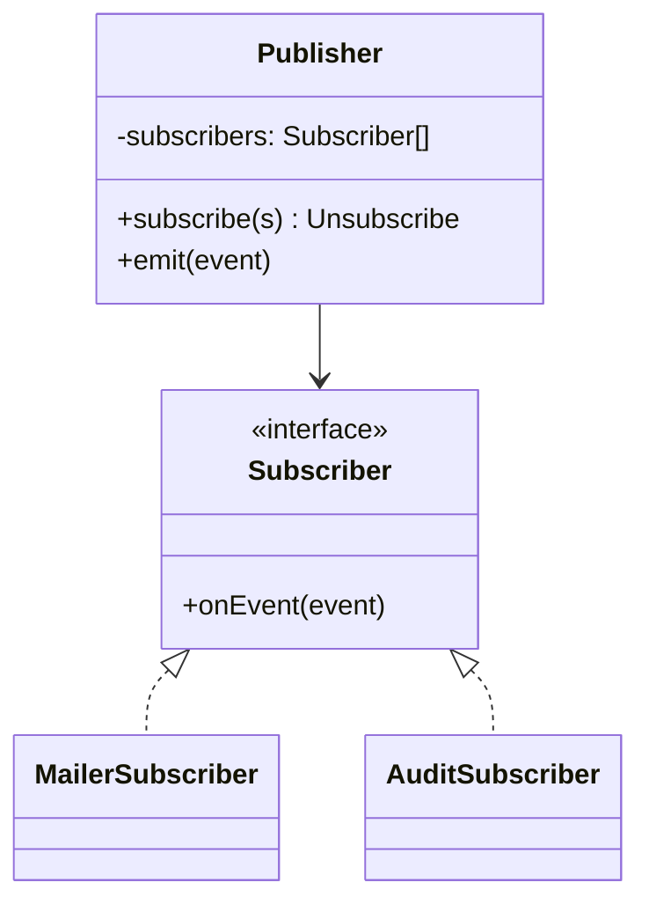

# Observer

**Category:** Behavioral
**Also known as:** Publish-Subscribe, Listener, Event-Subscriber
**Source:** https://refactoring.guru/design-patterns/observer

## Intent

Let one object announce that something happened, and let any number of other objects react, without the announcer knowing who they are. The source stops growing a call for each new reaction.

## Signals in code

- A core method ends with a list of unrelated follow-up calls (`sendEmail`, `updateSearchIndex`, `trackAnalytics`, `invalidateCache`). Each new feature adds one more line.
- A module imports many other modules only to notify them. The dependency graph points from the core to the edges.
- Polling loops that check whether a value changed. Search: `grep -nE "setInterval|while \(true\)|sleep\(" -r src`.
- Callback arrays built by hand (`this.handlers.push(fn)`). Search: `grep -nE "(listeners|handlers|callbacks|subscribers)\.push" -r src`.
- Circular imports between a domain module and the modules that react to it.
- Plugins or third parties need to run code when the core changes, and the core cannot know them.

## Do not use when

- There are one or two reactions, they always run, and they live in the same team. A direct call list is clearer. The reader sees the full flow in one function.
- The caller needs a result or must fail if a reaction fails. That is a function call or a transaction, not a notification.
- Order between reactions matters. Write the sequence explicitly, or use a pipeline or Chain of Responsibility.
- The event has exactly one consumer forever. Call the consumer, or pass a callback parameter.
- The UI framework already gives reactivity (React state, Vue refs, signals, RxJS). Use the native mechanism instead of a hand-made subject.

## Shape

- **Publisher (subject):** owns the event source and the subscriber list. It notifies on change.
- **Subscriber (observer):** the contract for receiving a notification. Usually one function.
- **Concrete subscriber:** reacts to the event.
- **Event payload:** the data passed with each notification. Prefer an immutable, typed object.



## Refactoring path

1. Find the method with the trailing follow-up calls. Write a test that asserts each follow-up still happens.
2. Define one typed event for the fact that occurred (`InvoicePaid { invoiceId, amount, paidAt }`). Name it in the past tense.
3. Use Extract Method so each follow-up becomes a function that takes only the event.
4. Stop point: the core method builds the event and calls the extracted handlers in a fixed list. This keeps order and errors explicit. Many teams should stop here.
5. Introduce a small typed emitter, or reuse the one the platform provides. Register the handlers at startup in one composition file.
6. Pin the current failure behavior with a test (today a failing follow-up throws to the caller). Keep that policy in the emitter, or ask the user before you change it.
7. Replace the fixed list with `emit(event)`. Keep the registration file as the single place that shows who listens.
8. Return an unsubscribe function from `subscribe`. Call it on teardown in components, tests and long-lived workers.
9. Move slow or remote handlers out of process (queue, outbox) only when latency or reliability demands it.

## Adaptations

- **Default for TypeScript and JavaScript:** a typed emitter where `subscribe` returns an unsubscribe function. Node's `EventEmitter` and the DOM `EventTarget` also work.
- **Python:** a list of callables, `blinker` signals, or Django signals. Avoid Django signals for core business flow, because they hide it.
- **Java, C#, Kotlin:** `event` in C#, Spring `ApplicationEventPublisher`, Kotlin `Flow`. Use `@TransactionalEventListener` to fire after commit.
- **Go:** channels or a slice of `func(Event)`. Close channels on shutdown to avoid leaking goroutines.
- **Frontend:** framework reactivity, signals or a store subscription. Clean up in `useEffect` return or `onUnmounted`.
- **Reactive streams (RxJS, Reactor):** use them when you need operators such as debounce, buffer or merge. They cost a steep learning curve.

## At architecture scale

- **Domain events:** an aggregate records facts. An application layer dispatches them after the transaction commits.
- **Pub/sub between services:** Kafka, SNS/SQS, Google Pub/Sub, NATS. Use the transactional outbox so a database write and its event cannot diverge.
- **Webhooks:** Observer across organizations. Add retries, signatures and idempotency keys.
- It is worth it when several teams react to the same fact or when the producer must not wait. It is not worth it inside one service with two reactions. A broker adds operations cost, eventual consistency and harder debugging.

## Trade-offs

**Gains:**
- New reactions do not change the publisher.
- Dependencies point toward the core, not away from it.
- Subscribers can attach and detach at runtime.

**Costs:**
- Debugging needs tracing or event logs.
- **Hidden control flow:** a reader of `emit` cannot see the effects. Keep one registration file and name events after facts.
- **Ordering:** most emitters call subscribers in registration order, but code should not rely on it. Make dependent steps explicit.
- **Error isolation:** one throwing subscriber can stop the others or fail the publisher. Wrap each call and decide the policy.
- **Memory leaks:** subscribers that are never removed keep their closures alive. Return an unsubscribe handle and test teardown.
- **Re-entrancy:** a subscriber that emits again can cause loops. Guard or queue nested emits.
- **Sync vs async:** a slow subscriber blocks the publisher when calls are synchronous.

## Neighbors

- **Mediator**: one hub coordinates peers that know only the hub. Observer has one-way links from a source to listeners. Ask: do the parts talk to each other, or only listen to one source?
- **Chain of Responsibility**: passes a request along handlers until one handles it. Ask: should exactly one handler act, or all of them?
- **Command**: turns a request into an object for queueing or undo. Ask: is this an instruction to do something, or a fact that already happened?

Often combined with: Mediator (hub implemented with events), State (emit on each transition), Command (queued event handlers).

## Minimal example

```typescript
declare const receipts: { send(invoiceId: string): Promise<void> };
declare const searchIndex: { update(invoiceId: string): Promise<void> };
declare const db: { invoices: { update(id: string, patch: { status: string }): Promise<void> } };

type InvoicePaid = { invoiceId: string; amountCents: number; paidAt: Date };
type Listener<E> = (event: E) => void | Promise<void>;

class Topic<E> {
  private listeners = new Set<Listener<E>>();

  subscribe(fn: Listener<E>): () => void {
    this.listeners.add(fn);
    return () => this.listeners.delete(fn); // caller must keep this to unsubscribe
  }

  async emit(event: E): Promise<void> {
    for (const fn of [...this.listeners]) {
      try { await fn(event); }
      catch (err) { console.error("listener failed", err); } // chosen policy: one failure does not stop the rest
    }
  }
}

export const invoicePaid = new Topic<InvoicePaid>();

// composition root: the one place that shows who reacts
invoicePaid.subscribe((e) => receipts.send(e.invoiceId));
invoicePaid.subscribe((e) => searchIndex.update(e.invoiceId));
// Financial writes (ledger entries) belong in the same transaction or an outbox, not in a best-effort listener.

// billing service: knows nothing about receipts or the search index
export async function markPaid(invoiceId: string, amountCents: number) {
  await db.invoices.update(invoiceId, { status: "paid" });
  await invoicePaid.emit({ invoiceId, amountCents, paidAt: new Date() });
}
```
