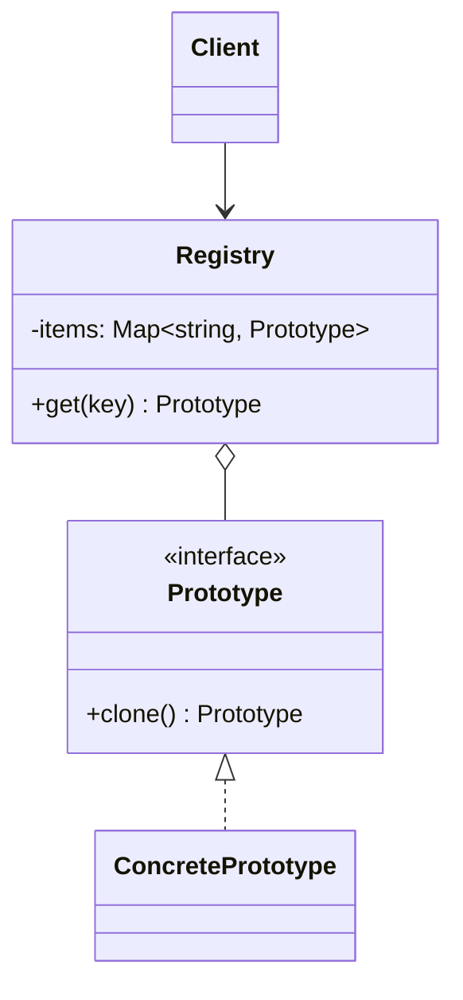

# Prototype

**Category:** Creational
**Also known as:** Clone
**Source:** https://refactoring.guru/design-patterns/prototype

## Intent

Create new objects by copying a configured instance instead of constructing them from zero. The object copies itself, so the caller needs neither its concrete class nor its private fields.

## Signals in code

- Subclasses that differ only in the values their constructors set. Search: `grep -nE "class \w+ extends \w+"` and look for bodies with only `super(...)` and field assignments.
- Long setup blocks copied across files to produce near-identical objects, with one or two fields changed.
- Code that copies objects field by field from outside the class, and breaks when someone adds a field.
- Shallow copies that cause shared-state bugs. Search: `grep -nE "\{ ?\.\.\.\w+ ?\}|Object\.assign\("` near nested arrays or maps.
- A function receives an object through an interface and must duplicate it, but cannot name its class.
- An undo history, a "duplicate" button or a "save as template" feature exists.
- Object creation is expensive (parsing, compiling, remote fetch), and many copies share the same base state.

## Do not use when

- Objects are plain data. Use `structuredClone()` in JavaScript, `copy.deepcopy()` in Python, or a spread for flat objects.
- Objects are immutable. Share the same instance, or create variations with a `with` copy (`{ ...preset, threshold: 5 }`).
- Objects hold live resources such as sockets, file handles or timers. A clone cannot copy them safely. Use a factory function that opens new resources.
- Presets are few and fixed. Use one factory function per preset.
- The object graph has cycles or shared references that you do not control. Cloning becomes error-prone. Rebuild from a serializable spec instead.

## Shape

- **Prototype:** an interface with a `clone()` method.
- **Concrete Prototype:** copies its own fields, including private ones, and decides deep or shallow copy per field.
- **Registry (optional):** a map from a key to a preconfigured prototype. It returns a clone on each request.
- **Client:** asks a prototype or the registry for a copy and then adjusts it.



## Refactoring path

1. List the subclasses or setup blocks that exist only to set field values. These are the presets.
2. Add a `clone()` method to the base class or interface. Write one test per class that changes the clone and checks the original is intact.
3. Implement `clone()` in each class. Decide per field: copy value, deep copy, or share on purpose. Document the shared fields.
4. Create one configured instance per preset. Put them in a registry map keyed by name.
5. Replace each `new PresetSubclass()` with `registry.get("preset")`. Do one call site per commit.
6. Inline the preset subclasses into data and delete them (Collapse Hierarchy).

**Stop point:** after step 3. A correct `clone()` already fixes duplicate-and-edit features and shallow-copy bugs, without a registry.

## Adaptations

- **Default for TypeScript/JavaScript:** for data objects, use `structuredClone()` plus a spread for overrides. Write a `clone()` method only for class instances with private state or methods, because `structuredClone` drops the prototype chain.
- **Python:** `copy.deepcopy()` with `__deepcopy__` overrides for fields that need custom handling. For dataclasses, `dataclasses.replace()` gives shallow copies with overrides.
- **Go:** write a `Clone()` method by hand. Copy slices and maps explicitly, because assignment shares them.
- **Rust:** `#[derive(Clone)]` covers concrete types. To clone through a trait object, add `fn clone_box(&self) -> Box<dyn Trait>` to the trait or use the `dyn-clone` crate, because `Clone` is not dyn-compatible.
- **Java/C#/Kotlin:** prefer a copy constructor or a `copy()` method over `Object.clone()` in Java. Kotlin data classes provide `copy(field = x)`. C# records provide `with` expressions.
- **Prototype-based languages:** JavaScript objects can use `Object.create(proto)` for shared defaults. This shares state, so it is not a copy. Do not confuse the two.

## At architecture scale

- Template resources: a project, a dashboard or an environment created by copying a reference instance, then customized.
- Configuration inheritance: a base service spec that each deployment copies and overrides (Kustomize overlays, Helm values).
- Event-sourced snapshots: a state copy saved at a point, so replay starts from it.
- Worth it when users create many entities from a few curated starting points. Not worth it when a declarative spec plus defaults expresses the same thing.

## Trade-offs

**Gains:**
- Callers copy objects without knowing their concrete class.
- Presets become data, so preset subclasses can go away.
- Expensive initialization runs once, and copies reuse the result.

**Costs:**
- Deep versus shallow copy must be decided per field, and mistakes cause shared-state bugs.
- Cycles and live resources make `clone()` hard to write correctly.
- Every new field must be added to `clone()`. Tests must catch omissions.

## Neighbors

- **Factory Method**: picks a class through subclass override, while Prototype copies an instance and needs no subclass per variant. Ask: do variants differ in behavior or only in data?
- **Builder**: assembles from empty in steps, while Prototype starts from a finished copy. Ask: are new objects small edits of existing ones?
- **Memento**: stores state for later restore with encapsulation. A clone can serve as a simple memento when the object has no external links. Ask: must the saved state stay hidden from other code?
- **Flyweight**: shares one instance on purpose, while Prototype creates independent copies. Ask: must copies change on their own?

Often combined with: Abstract Factory (a factory backed by prototypes), Command (copy commands into history), Composite and Decorator (clone whole structures).

## Minimal example

```ts
class AlertRule {
  private labels: Map<string, string>;

  constructor(
    public metric: string,
    public threshold: number,
    public channels: string[],
    labels: Record<string, string> = {},
  ) {
    this.labels = new Map(Object.entries(labels));
  }

  label(key: string, value: string): this { this.labels.set(key, value); return this; }

  clone(): AlertRule {
    const copy = new AlertRule(this.metric, this.threshold, [...this.channels]);
    copy.labels = new Map(this.labels);
    return copy;
  }
}

const presets = new Map<string, AlertRule>([
  ["latency", new AlertRule("p95_ms", 800, ["#oncall"], { severity: "page" })],
  ["errors", new AlertRule("error_rate", 0.02, ["#oncall", "email"], { severity: "ticket" })],
]);

function ruleFrom(preset: string): AlertRule {
  const base = presets.get(preset);
  if (!base) throw new Error(`unknown preset: ${preset}`);
  return base.clone();
}

const checkoutLatency = ruleFrom("latency").label("service", "checkout");
checkoutLatency.threshold = 500;
```
