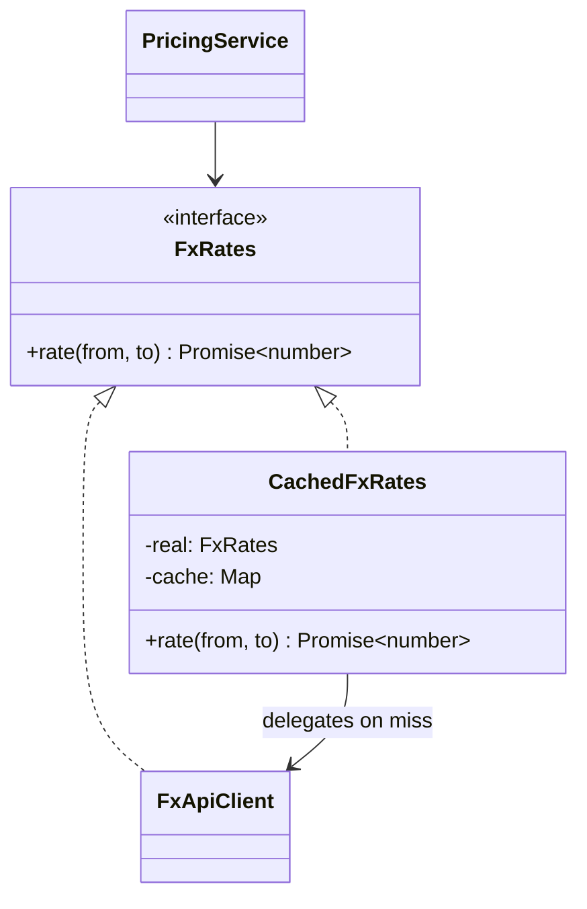

# Proxy

**Category:** Structural
**Also known as:** Surrogate, Stand-in
**Source:** https://refactoring.guru/design-patterns/proxy

## Intent

Put a stand-in object with the same interface in front of a real object, so you can control when and how clients reach it. The proxy can delay creation, cache results, check permissions or hide a network call, and the client does not see a difference.

## Signals in code

- Many callers check a cache before they call the same service, each with their own map and expiry logic. Search: `grep -rnE "cache\.(get|has)\(" src/ | wc -l`.
- Heavy objects (SDK clients, ML models, large files) created at startup but used by few requests.
- Permission checks repeated at the top of many methods of one service. Search: `grep -rnE "if ?\(!.*(canAccess|isAllowed|hasPermission)" src/`.
- Callers wrap a remote client in the same timeout, serialization and error mapping code.
- `let instance: X | null = null` plus "create if null" blocks copied in several modules.
- The real class is a vendor or `final` class, so you cannot add these checks inside it.

## Do not use when

- Only one caller needs the control. Put the check or the cache at that call site.
- The framework already gives it. Use the HTTP cache, the ORM lazy loader, the DI container lazy scope or the auth middleware.
- The caching needs request-level knowledge, such as user or tenant, that the interface does not carry. Cache in the caller or add the key to the interface first.
- The client must know about the extra behavior, for example to show a stale-data warning. Hidden behavior then becomes a trap. Use an explicit service.
- A memoized function covers the case. Use `memoize(fn)` or `functools.lru_cache`.

## Shape

- **Subject:** the interface shared by the real object and the proxy.
- **Real Subject:** the object that does the real work.
- **Proxy:** implements Subject and holds or creates the real object. It decides when to delegate.
- **Client:** works with Subject and cannot tell the proxy from the real object.

Common kinds: virtual (lazy creation), caching, protection (access control), remote (network stub), logging, and smart reference (counts users, frees resources).



## Refactoring path

1. Pick one control concern: lazy creation, cache, access check or remote call. Start with one concern per proxy. Combine only lazy creation with caching.
2. Extract Interface from the real class if clients depend on the concrete class.
3. If you cannot extract an interface, subclass the real class as a fallback. Document why. If the class is final, wrap it behind a new interface (Adapter-style) instead. In TypeScript, a proxy can `implements RealClass` directly when the class has no private members.
4. Create the proxy class. Implement every method as a plain delegation first. Run the tests.
5. Wire the pass-through proxy in the composition root or a factory. Clients receive Subject.
6. Move the control logic from the callers into the proxy, one caller per commit. Delete each local copy.
7. For caches, define the key, the expiry and the invalidation rule in writing before you ship.
8. Add tests for the proxy itself: miss, hit, expiry, denied access or failed lazy creation.

**Stop point:** after step 5, the seam exists and does nothing harmful. You can add control logic later, one concern at a time.

## Adaptations

- **TypeScript/JavaScript class (default):** a class that implements the interface, as in the example. It is explicit and type-safe.
- **JavaScript `Proxy` object:** intercepts every property access with a trap. Use it for generic proxies such as tracing, validation or reactive state. Vue and MobX use it. Avoid it for business logic, because readers cannot see what runs.
- **Lazy getter or factory function:** `let client; const getClient = () => (client ??= createClient());` is a virtual proxy without a class. Prefer it for single lazy objects.
- **Python:** a class with `__getattr__` for generic delegation, `functools.cached_property` for lazy attributes, and `lru_cache` for function results.
- **Java/C#:** `java.lang.reflect.Proxy`, Castle DynamicProxy and Spring AOP create proxies at runtime. Hibernate and Entity Framework use them for lazy loading.
- **Go and Rust:** a struct that wraps the real one and implements the same interface or trait. Rust `OnceCell`/`LazyLock` covers the lazy case.
- **gRPC and OpenAPI clients:** generated stubs are remote proxies. Do not write your own over them unless you add a concern.

## At architecture scale

- **Reverse proxy and load balancer:** NGINX, Envoy or a cloud load balancer stands in front of servers with the same HTTP interface.
- **CDN and HTTP caches:** a caching proxy at the network edge, controlled by `Cache-Control` headers.
- **Sidecar proxy:** a service mesh sidecar intercepts all traffic of one service to add mTLS, retries and access policy.
- **Remote proxies:** RPC stubs and SDK clients make a remote service look local. Watch for hidden latency and partial failure.
- **ORM lazy loading:** a related entity is a proxy that queries the database on first access. This can cause the N+1 query problem. Check the query count in tests.
- **Auth gateway or policy enforcement point:** a protection proxy for a group of services.

The infrastructure form is worth it when several services need the same control. Use off-the-shelf proxies there instead of custom code. Keep an in-code proxy when the control needs domain knowledge, such as a cache key built from business fields.

## Trade-offs

**Gains:**
- Callers get caching, lazy creation or access checks with no code change.
- Control logic lives in one place.
- The proxy can answer even when the real object is not ready, for example from cache.

**Costs:**
- Hidden behavior. Stale data, latency or denied calls surprise callers.
- A remote proxy hides the network and invites chatty calls.
- Cache invalidation and lifecycle bugs move into the proxy.
- One more layer to step through when you debug.

## Neighbors

- **Decorator**: the client composes decorators to add features, while a proxy controls access and often manages the real object lifecycle. Ask: who builds the wrapper, and is the goal new behavior or controlled access?
- **Adapter**: Adapter changes the interface, while Proxy keeps it identical. Ask: can the client swap the wrapper for the real object with no change?
- **Facade**: Facade gives a new simple interface over many objects. Ask: does the wrapper stand in for exactly one object with the same interface?
- **Flyweight**: a flyweight factory shares state objects, while a caching proxy stores results. Ask: are you caching answers or the objects themselves?

Often combined with: Factory Method (decide proxy or real object), Decorator (in the same wrapper stack), Singleton (one shared virtual proxy).

## Minimal example

```ts
interface FxRates {
  rate(from: string, to: string): Promise<number>;
}

// Real subject: slow and rate-limited remote API.
class FxApiClient implements FxRates {
  async rate(from: string, to: string): Promise<number> {
    const res = await fetch(`https://fx.example.com/v1/${from}/${to}`);
    return (await res.json()).rate;
  }
}

// Caching and lazy proxy: same interface, controls access to the real client.
class CachedFxRates implements FxRates {
  private real?: FxRates;
  private cache = new Map<string, { value: Promise<number>; expires: number }>();

  constructor(private create: () => FxRates, private ttlMs = 60_000) {}

  rate(from: string, to: string): Promise<number> {
    const key = `${from}:${to}`;
    const hit = this.cache.get(key);
    if (hit && hit.expires > Date.now()) return hit.value;
    this.real ??= this.create(); // created only on first miss
    // Cache the promise before it settles, so concurrent misses share one call.
    const value = this.real.rate(from, to);
    const entry = { value, expires: Date.now() + this.ttlMs };
    this.cache.set(key, entry);
    value.catch(() => {
      if (this.cache.get(key) === entry) this.cache.delete(key);
    });
    return value;
  }
}

// Clients depend on FxRates and do not know a proxy exists.
const rates: FxRates = new CachedFxRates(() => new FxApiClient());
```
