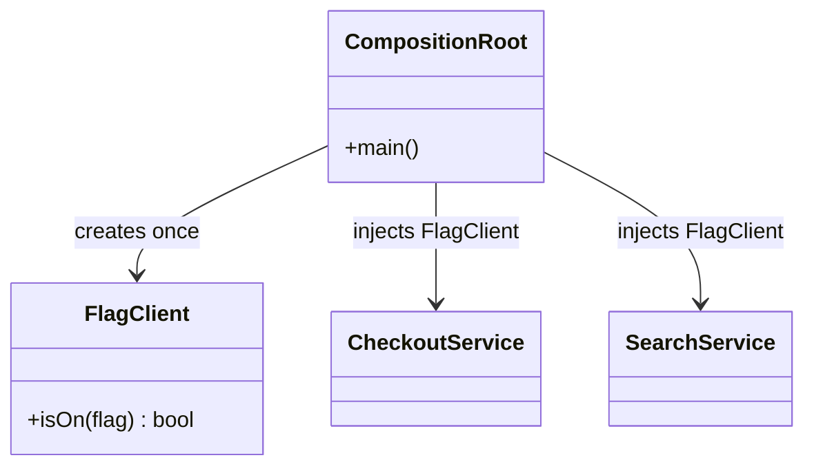

# Singleton

**Category:** Creational
**Also known as:** none
**Source:** https://refactoring.guru/design-patterns/singleton

## Intent

Guarantee one instance of a class and give all code a global way to reach it. In modern code this is usually an anti-pattern: keep the "one instance" and drop the "global access".

## Signals in code

Signals that a Singleton already exists and causes harm:

- Static accessors. Search: `grep -nE "getInstance\(|\.instance\b|static\s+(_)?instance"`.
- Module-level mutable state imported from many files. Search: `grep -nE "^export (let|const) \w+ = new "`.
- Tests that need `resetInstance()`, `jest.resetModules()`, or a fixed run order to pass. This is test pollution.
- Functions whose signatures look pure but read config, clocks, loggers or clients from a global. The dependency is hidden.
- Lazy init with locks or flags (`if (!instance)`) and race bugs under concurrency or in multi-worker setups.
- A "Manager", "Registry" or "Context" class that every layer imports, and that keeps growing.

Signals that one shared instance is a real requirement:

- A process-wide resource with a hard limit: one connection pool, one hardware handle, one metrics registry the runtime expects.
- An expensive immutable object (a compiled schema, a loaded model) that all callers can share safely.

Even in these cases, enforce "one" at the composition root, not inside the class.

## Do not use when

**Default recommendation:** create one instance at startup (the composition root) and pass it explicitly through constructors or parameters. Use a DI container scope if the project already has one. Do not add a new Singleton. Treat existing ones as candidates for removal.

- You only want convenient access. Pass the dependency, or group several into a context object.
- The object holds per-request or per-user state. Use a request scope or pass the state explicitly.
- Tests need different configurations. A global prevents parallel tests. Use constructor injection.
- The code runs in many processes, workers or serverless instances. A Singleton is per process, not global. Use an external store for real shared state.
- The object is stateless. Use plain functions in a module.
- The object is immutable configuration. Use a frozen module-level constant that callers import or receive.

## Shape

- **Singleton (classic):** private constructor, static field, static `getInstance()`.
- **Preferred shape:** a normal class, one instance created in `main`, passed to consumers through constructors.



## Refactoring path

Path AWAY from an existing Singleton. Each step keeps tests green.

1. Find all callers. Search for `getInstance(` or the exported instance name. Count them to size the work.
2. Extract Interface from the Singleton class for the methods that callers use.
3. Make the constructor public. Keep `getInstance()` working, so nothing breaks yet.
4. Pick one leaf caller. Add a constructor parameter typed with the interface, with a default of `Singleton.getInstance()`. This is a safe transitional seam.
5. Update the tests of that caller to pass a fake. Remove the reset hacks for that caller.
6. Repeat steps 4 and 5 caller by caller, from leaves toward the entry point.
7. Create the instance once in the composition root and pass it down. Remove the default parameter values.
8. Delete `getInstance()` and the static field. Add a lint rule that bans new static instance accessors.

**Stop point:** after step 5 for the most-tested modules. The global still exists, but the code under active change is now testable. The default-parameter seam is safe to leave in place.

If a team insists on keeping a Singleton, make it immutable after init, and make its creation eager and thread-safe. Also expose a test-only replacement hook.

## Adaptations

- **Default for TypeScript/JavaScript:** create a normal class instance in the entry file and pass it explicitly. ES modules are cached, so `export const x = new X()` is already a singleton. Use it only for immutable values.
- **Python:** modules are singletons by nature. Prefer a factory function called once in `main` and passed down. Avoid metaclass Singletons. `functools.cache` on a getter is a lighter global, but still a global.
- **Go:** create in `main` and pass through structs. If a lazy global is truly needed, use `sync.Once` and keep it unexported.
- **Rust:** pass `Arc<T>` explicitly. Use `std::sync::OnceLock` or `LazyLock` only for immutable global data.
- **Java/C#/Kotlin:** register the class as singleton-scoped in the DI container (Spring default scope, `AddSingleton` in .NET, Koin `single`). Kotlin `object` is a language Singleton, so keep it stateless.
- **React:** put the instance in a context provider at the root. Tests wrap components with a provider that holds a fake.

## At architecture scale

- A "single source" service (one ID generator, one leader) is the distributed form. It is a bottleneck and a single point of failure.
- Prefer leader election, partitioned ownership or idempotent operations over one global instance.
- A shared configuration service is acceptable when clients cache values locally and receive them as explicit inputs.
- Worth it only when correctness requires exactly one writer. Not worth it for convenience or for a cache that could be per-node.

## Trade-offs

**Gains:**
- Exactly one instance of a scarce resource per process.
- Lazy initialization of an expensive object.

**Costs:**
- Hidden dependencies: signatures do not show what a function reads.
- Global mutable state couples distant modules and creates order-of-execution bugs.
- Test pollution: state leaks between tests, and parallel tests fail.
- The class has two jobs, its domain logic and its own lifecycle.
- Thread-safety work for lazy init, and "one per process" is often not what the team assumed.

## Neighbors

- **Dependency injection**: gives the same single instance without global access. Ask: can the creator of the consumers also pass this object to them?
- **Flyweight**: shares many immutable instances keyed by intrinsic state, not one mutable instance. Ask: are there several shared variants?
- **Facade**: a facade often needs only one instance, but it does not need global access to get that. Ask: is the single instance a requirement or a habit?
- **Monostate / module constant**: shares state through static fields or module scope with normal construction. Ask: is the shared data immutable?

Often combined with: Abstract Factory, Builder and Facade, when one instance is enough. Prefer a container-managed single scope for these.

## Minimal example

```ts
// Before: a hidden global dependency.
// class FlagClient { static instance = new FlagClient(); ... }
// export function priceFor(sku: string) { if (FlagClient.instance.isOn("promo")) ... }

interface Flags {
  isOn(flag: string): boolean;
}

class FlagClient implements Flags {
  constructor(private readonly values: ReadonlyMap<string, boolean>) {}
  isOn(flag: string): boolean { return this.values.get(flag) ?? false; }
}

class PricingService {
  constructor(private readonly flags: Flags) {}
  priceFor(baseCents: number): number {
    return this.flags.isOn("promo-10") ? Math.round(baseCents * 0.9) : baseCents;
  }
}

// Composition root: the only place that decides "one instance".
function main() {
  const flags = new FlagClient(new Map([["promo-10", true]]));
  const pricing = new PricingService(flags);
  console.log(pricing.priceFor(2500));
}

// Test: no reset hooks, no shared state between tests.
const off: Flags = { isOn: () => false };
console.assert(new PricingService(off).priceFor(2500) === 2500);
```
