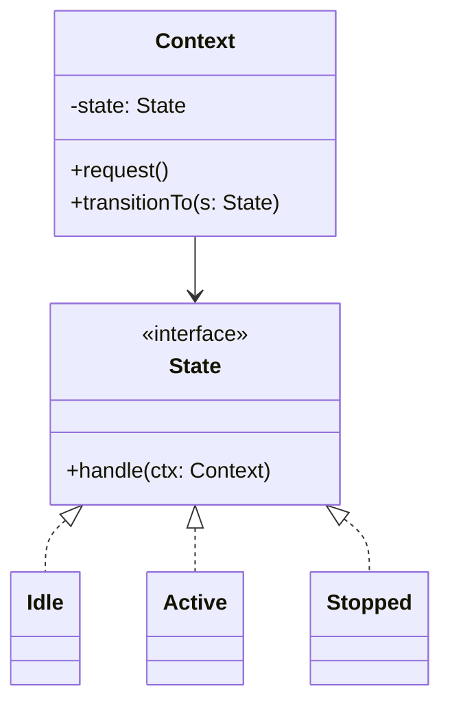

# State

**Category:** Behavioral
**Also known as:** Objects for States
**Source:** https://refactoring.guru/design-patterns/state

## Intent

Let an object change its behavior when its internal mode changes, without a mode check in every method. Each mode owns its own rules and decides which mode comes next.

## Signals in code

- A `status`, `phase` or `mode` field that many methods read in a `switch` before they act. Search: `grep -rnE "switch \(this\.(status|state|phase)\)" -r <src-dir> <src-dir>`.
- Guard clauses such as `if (order.status !== "paid") throw` repeated across services.
- Transition rules spread over several files. Nobody can draw the full diagram from one place.
- Bugs where an entity reached an "impossible" status, for example `shipped` without `paid`.
- Boolean pairs that encode a mode (`isOpen && !isLocked`). Search: `grep -rnE "is[A-Z]\w+ && !is[A-Z]" -r <src-dir> <src-dir>`.
- Fields that are valid only in some modes (`cancelledAt`, `retryCount`) and are `null` the rest of the time.

## Do not use when

- There are two or three modes and only one method depends on them. A `switch` is clearer.
- Behavior per mode differs only in which transitions are allowed. Use a transition table: a map from `(state, event)` to the next state and an optional side effect.
- The machine is large, nested, has timers or parallel regions, or needs a diagram for product people. Use a state-machine library (XState in TS, `transitions` in Python, Spring Statemachine in Java).
- The status lives in a database and many services change it. Enforce transitions in one place: a domain service that writes with a conditional update (`UPDATE ... SET status = 'shipped' WHERE id = ? AND status = 'paid'`, then check the row count), or a trigger. Per-state classes in one process do not protect the data.
- The "states" are configuration that never changes at runtime. That is Strategy or plain config.

## Shape

- **Context:** the object clients use. It holds the current state and forwards mode-dependent calls to it.
- **State:** the contract for mode-dependent operations.
- **Concrete state:** the behavior for one mode. It can ask the context to move to another state.
- **Transition:** replacing the state reference in the context. States or the context can trigger it.



## Refactoring path

1. List every mode and every event. Draw the transition diagram from the current code. Missing or odd transitions often show up here.
2. Write tests for each legal transition and for each illegal one. Pin the current behavior first.
3. Replace the raw string or number with a union type or enum. Centralize all writes to the field in one `transition(event)` method.
4. Stop point: put the allowed transitions in a table that `transition` reads. Many codebases need nothing more. Stop here if behavior per state is mostly the same.
5. If several methods still `switch` on the mode, apply Replace Type Code with State. Declare a state interface with only the mode-dependent methods.
6. If the entity is persisted, keep the stored column a plain value and add a factory `fromStatus(value)` now, before the classes replace the field.
7. Create one class per mode. Use Move Method to move each branch into its class.
8. Give the context a `transitionTo` method. Let states call it, or let them return the next state. Returning the next state is easier to test.
9. Replace the `switch` blocks in the context with calls to the current state.

## Adaptations

- **Default:** a transition table plus a union type. It is data, it is easy to read and it is easy to print as a diagram.
- **When classes win:** each mode changes the behavior of many methods, not only the allowed transitions. Examples are protocol handlers, circuit breakers and game entities.
- **TypeScript:** a discriminated union per state (`{ kind: "open"; since: Date }`) puts mode-only fields on the right variant. An exhaustive `switch` with `never` catches missing cases.
- **XState or similar:** use it when you need guards, delays, nested states, history or visual tooling. It costs one dependency and a learning curve.
- **Python:** an `Enum` and a dict of transitions. Use the `transitions` library for larger machines.
- **Rust:** an `enum` with data per variant and `match`. Typestate (one type per state) makes illegal calls fail at compile time.
- **Java, Kotlin:** sealed classes or an `enum` with per-constant method bodies.
- **Frontend:** a reducer with `(state, action) => state` is already a state machine. Keep it exhaustive.

## At architecture scale

- **Workflow engines and sagas:** a long process across services is a state machine with persisted state. Temporal, AWS Step Functions and Camunda make the machine explicit.
- **Entity lifecycle in the database:** an order or ticket status column. Guard it with one service that owns the transitions and emits an event on each change.
- **Event sourcing:** the current state is a fold over events. The transition function is the core of the aggregate.
- It is worth it when the lifecycle spans days, retries or human steps. It is not worth it for a status with three values that one service owns.

## Trade-offs

**Gains:**
- Each mode is readable and testable on its own.
- Illegal transitions have one place to fail.
- Adding a mode does not touch the code of the other modes.

**Costs:**
- Many small classes for a machine that may fit in a ten-line table.
- Transitions spread across state classes are harder to see as a whole than a table.
- States often need access to context internals, which widens its interface.

## Neighbors

- **Strategy**: the client picks a strategy, and strategies do not know each other. Ask: does the object change its own behavior in response to events?
- **Command**: encodes a request, not a mode. Ask: is this an action, or a phase in a lifecycle?
- **Memento**: saves and restores state snapshots. Ask: do you need undo, or only legal transitions?
- **Flyweight**: stateless state objects can be shared singletons. Ask: do your state objects hold per-instance data?

Often combined with: Observer (emit an event per transition), Flyweight (shared stateless states), Factory Method (rebuild state from a stored value).

## Minimal example

```typescript
interface BreakerState {
  call<T>(breaker: CircuitBreaker, fn: () => Promise<T>): Promise<T>;
}

class Closed implements BreakerState {
  private failures = 0;
  async call<T>(b: CircuitBreaker, fn: () => Promise<T>) {
    try { const r = await fn(); this.failures = 0; return r; }
    catch (e) { if (++this.failures >= 3) b.moveTo(new Open()); throw e; }
  }
}

class Open implements BreakerState {
  private openedAt = Date.now();
  async call<T>(b: CircuitBreaker, fn: () => Promise<T>) {
    if (Date.now() - this.openedAt < 30_000) throw new Error("circuit open");
    b.moveTo(new HalfOpen());
    return b.call(fn);
  }
}

class HalfOpen implements BreakerState {
  async call<T>(b: CircuitBreaker, fn: () => Promise<T>) {
    try { const r = await fn(); b.moveTo(new Closed()); return r; }
    catch (e) { b.moveTo(new Open()); throw e; }
  }
}

class CircuitBreaker {
  private state: BreakerState = new Closed();
  moveTo(next: BreakerState) { this.state = next; }
  call<T>(fn: () => Promise<T>) { return this.state.call(this, fn); }
}
```
