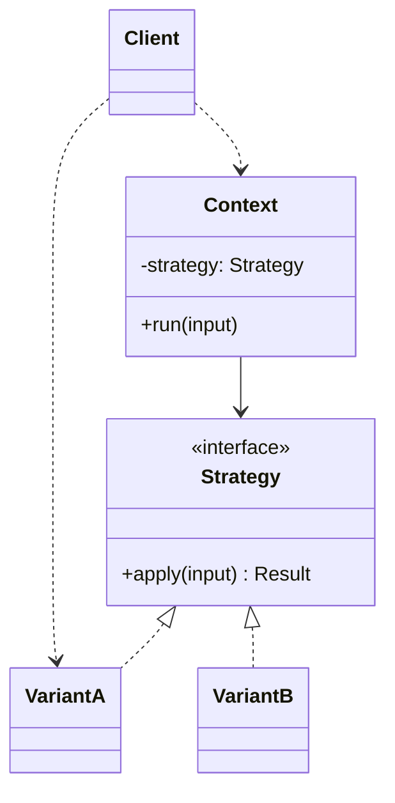

# Strategy

**Category:** Behavioral
**Also known as:** Policy
**Source:** https://refactoring.guru/design-patterns/strategy

## Intent

Put each variant of one algorithm behind a shared contract, so the caller picks a variant without knowing how it works. The calling code stops growing each time a new variant arrives.

## Signals in code

- A `switch` or `if/else` chain on a mode, kind or provider name that selects how to compute one result. Search: `grep -nE "case ['\"][a-z_]+['\"]:" -r src | sort | uniq -c`.
- The same mode check appears in two or more functions or files. Each new mode forces edits in all of them.
- A method has a boolean or enum flag that changes its whole body (`calculate(order, useNewRules)`). Search: `grep -nE "\((.*, )?(use|is|enable)[A-Z]\w+\)" -r src`.
- Sibling classes differ only in one method body. The rest is copied.
- Tests for one variant need to set up mocks for the dependencies of all other variants.
- Merge conflicts cluster on one large "engine" or "calculator" file.
- A comment such as `// TODO: add provider X here` sits next to a branch list.

## Do not use when

- There are two variants and no third one is planned. Keep the `if`. It is easier to read than an interface.
- The variants differ only in numbers, labels or thresholds. Use a lookup table or config object (`const RATES = { basic: 0.02, pro: 0.01 }`).
- The language has first-class functions and the variant has no state. Pass a function or keep a map of functions. Do not create one class per variant.
- The selection happens once at startup and never changes. A config value plus a factory function is enough.
- The variants need very different inputs. A forced common signature hides the differences and leaks optional parameters. Keep separate functions.
- The caller cannot know which variant to pick. The pattern moves the choice to the client, so it must have that knowledge.

## Shape

- **Context:** holds a reference to one strategy and calls it. It does not know the concrete variant.
- **Strategy:** the contract all variants follow. Usually one method or one function type.
- **Concrete strategy:** one variant of the algorithm.
- **Client:** selects a concrete strategy and gives it to the context.



## Refactoring path

1. Write characterization tests for each branch of the conditional. Cover each mode at least once.
2. Use Extract Method on each branch body. Give every extracted method the same signature. Use Introduce Parameter Object if the inputs differ a little.
3. Stop point: the conditional now only dispatches to small named functions. This is often enough. Stop here if there are fewer than four variants.
4. Declare the strategy type. In TypeScript, a function type is the default: `type Backoff = (attempt: number) => number`.
5. Move each extracted method into a map keyed by the mode (`Record<Mode, Backoff>`). Replace the conditional with one lookup. This is Replace Conditional with Polymorphism in its lightest form.
6. If a variant needs its own state or dependencies, turn only that entry into a class or a closure factory. Keep the others as plain functions.
7. Inject the strategy into the context through the constructor or a parameter. Remove the mode string from the context.
8. Delete the duplicate conditionals in other files. They now call the same map or receive the injected strategy.
9. Add a test that fails when a mode has no entry. In TypeScript, `Record<Mode, ...>` already gives a compile error.

## Adaptations

- **Default for TypeScript, JavaScript and Python:** a function parameter or a dictionary of functions. Use classes only when a variant carries state or many collaborators.
- **Data-only variants:** a lookup table of values beats any code structure. Move the table to config if non-developers change it.
- **Python:** a dict of callables or `functools.partial`. Use `typing.Protocol` when a strategy needs more than one method.
- **Go:** a function type (`type Pricer func(Order) Money`) or a one-method interface. Both are idiomatic.
- **Rust:** a closure parameter with generics for static dispatch. Use `Box<dyn Trait>` when the choice happens at runtime.
- **Java, C#, Kotlin:** a functional interface with lambdas. Use full classes when the strategy has injected dependencies.
- **DI containers:** register each variant under a key and resolve by key. Spring, NestJS and .NET support named or keyed providers.
- **React:** pass a function prop (render prop, `sortFn`, `formatter`). A strategy object in context is rarely necessary.

## At architecture scale

- **Pluggable providers:** payment gateways, LLM vendors or storage backends behind one port. This is Strategy at the service boundary, often combined with Adapter.
- **Feature flags and experiments:** a flag selects one of two code paths. Treat each path as a strategy so the old path is easy to delete.
- **Per-tenant policies:** tenants pick pricing, routing or retention rules from a registry. Store the key in tenant config, not the code.
- It is worth it when providers change on their own schedule or when teams own separate variants. It is not worth it for one provider "in case we switch". That abstraction usually fits the second vendor badly.

## Trade-offs

**Gains:**
- New variants do not change the context.
- Each variant is testable in isolation with its own dependencies.
- Variants can be swapped at runtime.

**Costs:**
- More files and indirection when variants are few or stable.
- The client must know which variant fits.
- A common signature can force awkward inputs on some variants.

## Neighbors

- **State**: state objects know about each other and trigger transitions, strategies do not. Ask: does the object switch the variant by itself as events happen?
- **Template Method**: varies steps through subclassing, fixed at compile time. Ask: do you need to change the behavior without a new subclass?
- **Command**: wraps a request so it can be queued, logged or undone. Ask: is the object an action to run later, or a way to compute something now?
- **Decorator**: adds behavior around an object. Strategy replaces the inner logic. Ask: do you wrap the result, or replace how it is produced?
- **Bridge**: splits two dimensions that vary on their own. Ask: are there two independent axes of variation?

Often combined with: Factory Method (to pick the strategy), Adapter (to fit third-party providers), Dependency Injection.

## Minimal example

```typescript
type Backoff = (attempt: number) => number; // returns delay in ms

const backoffs: Record<"none" | "fixed" | "exponential", Backoff> = {
  none: () => 0,
  fixed: () => 500,
  exponential: (attempt) => Math.min(100 * 2 ** attempt, 10_000),
};

class RetryingClient {
  constructor(
    private send: (body: string) => Promise<Response>,
    private backoff: Backoff,
    private maxAttempts = 4,
  ) {}

  async post(body: string): Promise<Response> {
    for (let attempt = 0; ; attempt++) {
      const res = await this.send(body);
      if (res.ok || attempt + 1 >= this.maxAttempts) return res;
      await new Promise((r) => setTimeout(r, this.backoff(attempt)));
    }
  }
}

// The client picks the policy from config. RetryingClient never checks a mode string.
const client = new RetryingClient(
  (body) => fetch("/api/events", { method: "POST", body }),
  backoffs[process.env.RETRY_POLICY as keyof typeof backoffs] ?? backoffs.fixed,
);
```
