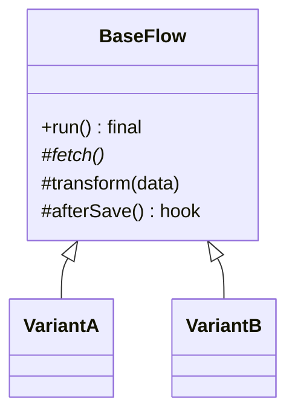

# Template Method

**Category:** Behavioral
**Also known as:** none
**Source:** https://refactoring.guru/design-patterns/template-method

## Intent

Fix the order of steps in an algorithm in one place, and let variants supply only the steps that differ. Shared steps stop being copied across near-identical implementations.

## Signals in code

- Two or more classes or functions with the same sequence of steps. Only one or two steps differ. A diff between them shows mostly identical lines.
- Copy-pasted "job", "importer", "handler" or "exporter" files with names like `ImportCsvJob`, `ImportXlsxJob`. Search: `grep -rlE "class \w+(Job|Importer|Exporter|Handler)\b" src`.
- A bug fix in the shared part had to be applied to every copy, or was missed in one.
- Base classes with `protected abstract` methods and one public method that calls them. The pattern exists already, maybe partly.
- Subclasses override a step only to do nothing, or to throw "not supported". Search: `grep -nE "override .*\{\s*\}" -r src`.

## Do not use when

- There are two copies and they rarely change. Accept the duplication, or extract the shared steps into helper functions.
- The variants differ in which steps run or in their order, not only in step content. Write each flow explicitly, or build a pipeline of step functions.
- The class already extends another base. Inheritance is a single slot. Pass the varying steps as functions instead.
- The varying step must change at runtime or per call. Use Strategy or a function parameter.
- The framework already gives lifecycle hooks (test `beforeEach`, middleware, ORM callbacks, React effects). Use them instead of a custom base class.

## Shape

- **Template method:** the public method that calls the steps in a fixed order. Subclasses must not override it.
- **Abstract step:** a step that every variant must provide.
- **Default step:** a step with a shared body that a variant may replace.
- **Hook:** an optional step with an empty default body, placed before or after a key step.
- **Concrete variant:** supplies the abstract steps and selected overrides.



## Refactoring path

1. Put the near-duplicate implementations side by side. Mark which lines are the same and which differ.
2. Write tests that pin the output of each variant.
3. In each copy, use Extract Method so each step is one method with the same name and signature in every copy.
4. Stop point: the copies now differ only in a few named step methods. Shared steps can move to plain helper functions. This is often enough.
5. Choose the mechanism. For new code, default to composition: one function that takes the varying steps as parameters or an object of hooks. Use inheritance only when the rules below apply.
6. With composition: write `runFlow(steps)` with the fixed order. Make each variant a `steps` object. Delete the copies.
7. With inheritance: create the base class, then use Pull Up Method for each identical step. Declare the differing steps abstract. Make the template method non-overridable (`final`, `sealed`, or a documented rule in TS).
8. Add hooks only where a real variant needs them. Each unused hook is an extension point someone must keep stable.
9. Delete step overrides that do nothing. If several exist, the step does not belong in the template.

## Adaptations

- **Default for new code:** composition. Pass the steps as functions or as an object of hooks to one function. This is Strategy applied to steps, and it avoids inheritance coupling.
- **When inheritance is still fine:** the hierarchy is shallow (one level), small, owned by one team, and the framework expects it. Examples are JUnit or Django class-based views, and abstract base classes in an existing codebase.
- **TypeScript:** no `final` keyword. Use a function with a hooks object, or document the rule and test it.
- **Python:** `abc.ABC` with `@abstractmethod`. Prefer passing callables for new code.
- **Go:** no inheritance. Use a function that takes an interface of steps.
- **Rust:** a trait with required methods and default methods. The provided method acts as the template.
- **Java, C#, Kotlin:** abstract class with a `final` or non-virtual template method. Kotlin classes are final by default, which helps.
- **Frameworks:** lifecycle hooks, middleware chains and test fixtures already apply this idea. Plug into them.

## At architecture scale

- **Frameworks:** inversion of control is Template Method at large. The framework owns the flow and calls your code at fixed points.
- **Workflow skeletons:** a shared pipeline (ingest, validate, enrich, store) where each data source supplies its own fetch and parse steps.
- **Service templates and SDKs:** a platform team ships a base that fixes logging, auth and retries. Product teams fill in the handler.
- It is worth it when many teams repeat the same flow and the platform owns cross-cutting rules. It is not worth it when every consumer needs to bend the flow. They will fork the template.

## Trade-offs

**Gains:**
- The sequence lives in one place. Fixes apply to all variants.
- Variants contain only what differs.
- Clear, named extension points.

**Costs:**
- Inheritance couples variants to base class internals.
- The fixed skeleton limits variants that need a different flow.
- Many steps and hooks make the base hard to change safely.
- A subclass that disables a default step can break substitutability.

## Neighbors

- **Strategy**: varies a whole algorithm through composition at runtime. Ask: does the variant need to change per call or per instance?
- **Factory Method**: a special template step that creates an object. Ask: is the varying step only "which object to create"?
- **Chain of Responsibility / middleware**: steps are a list that can change. Ask: is the order of steps fixed, or configurable?
- **Decorator**: wraps behavior before and after. Ask: do you add work around a call, or fill a gap inside a flow?

Often combined with: Factory Method (as one step), Strategy (steps passed as objects), Hooks pattern in frameworks.

## Minimal example

```typescript
// The fixed flow for every inbound webhook provider.
interface WebhookSteps<E> {
  verify(rawBody: string, headers: Headers): boolean;
  parse(rawBody: string): E;
  handle(event: E): Promise<void>;
  isDuplicate?(event: E): Promise<boolean>; // optional hook
}

async function processWebhook<E>(
  steps: WebhookSteps<E>,
  rawBody: string,
  headers: Headers,
): Promise<number> {
  if (!steps.verify(rawBody, headers)) return 401;
  const event = steps.parse(rawBody);
  if (await steps.isDuplicate?.(event)) return 200;
  await steps.handle(event);
  return 204;
}

// One provider only supplies what differs.
const shippingCarrier: WebhookSteps<{ trackingId: string; status: string }> = {
  verify: (body, h) => h.get("x-carrier-signature") === sign(body),
  parse: (body) => JSON.parse(body),
  handle: (e) => shipments.updateStatus(e.trackingId, e.status),
};

// Usage: processWebhook(shippingCarrier, body, request.headers)
```
