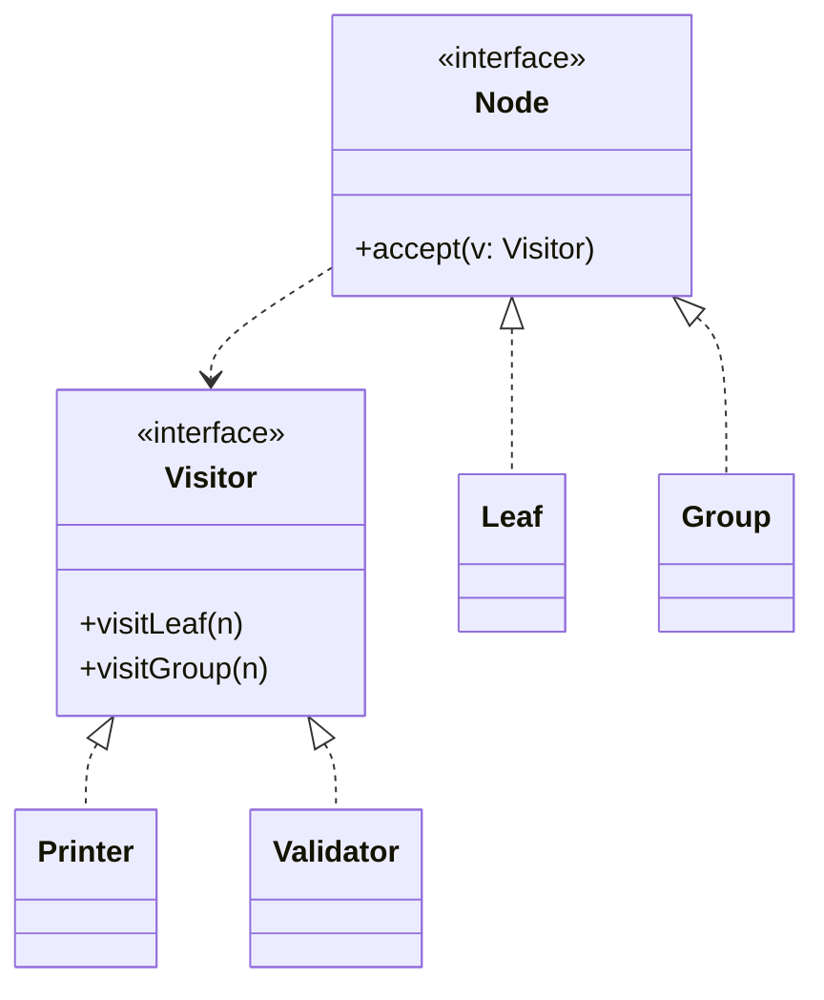

# Visitor

**Category:** Behavioral
**Also known as:** none (uses double dispatch)
**Source:** https://refactoring.guru/design-patterns/visitor

## Intent

Add new operations over a fixed set of node types without editing those types each time. Each operation lives in one place and handles every node type.

## Signals in code

- A tree or graph of different node classes (AST, rule tree, document model, UI schema) with many unrelated operations on it.
- Node classes collect methods for printing, validating, evaluating, serializing and pricing. Each method has one implementation per node class.
- `instanceof` or type-tag chains that walk a structure. Search: `grep -rnE "instanceof (\w+Node|\w+Expr)" <src-dir>`.
- A new operation forces edits in every node class file.
- The same recursive walk is copied in several functions. Only the per-node action differs.
- Existing `accept(visitor)` methods. Check if every visitor needs every node type.

## Do not use when

- The language has discriminated unions or pattern matching with exhaustiveness checks. Use a `switch` or `match` over a union. This covers TypeScript, Rust, Kotlin sealed classes, Scala, Swift, and Java 17+ sealed types with Java 21 pattern `switch`. Python 3.10 `match` also works, but it has no exhaustiveness check. Use pyright or mypy with `assert_never`.
- Node types change more often than operations. Visitor makes each new node type a change to every visitor. Keep methods on the nodes.
- There are one or two operations. Put them on the nodes, or write one function with a `switch`.
- The structure is homogeneous (one node type with a `kind` field). A map from `kind` to handler is enough.
- A library already provides traversal (Babel, ts-morph, ESLint rules, Python `ast.NodeVisitor`, Roslyn). Use its visitor API.

## Shape

- **Element:** a node type. In classic Visitor it has `accept(visitor)` that calls the matching visitor method.
- **Visitor:** declares one method per element type.
- **Concrete visitor:** one operation over all element types. It can collect results while it walks.
- **Object structure:** the tree or collection that is traversed.



## Refactoring path

1. List node types and operations as a grid. Count how many operations exist on each node class.
2. Write tests for each operation on a sample tree that contains every node type.
3. Pick the dispatch mechanism. If the language has unions and exhaustive matching, model the nodes as a union and skip `accept`. Otherwise use classic double dispatch.
4. Choose one operation. Use Extract Method so its per-node logic is a function that takes the node as a parameter.
5. Use Move Method to put those functions into one visitor (or one `switch` function). Keep the old node method as a delegate.
6. Stop point: one operation now lives outside the nodes. Check that the code reads better before you move the next one.
7. Move the remaining operations one at a time. Remove the delegate methods from the nodes when no caller uses them.
8. Separate traversal from action if several visitors need the same walk. Put the walk in one generic function.
9. Add an exhaustiveness check: a `never` default in TS, no wildcard arm in Rust, a sealed hierarchy in Kotlin or Java.

## Adaptations

- **Default for TypeScript:** a discriminated union and a `switch` on `kind`, with a `default` that assigns to `never`. Each operation is one function.
- **Rust:** `enum` plus `match`. Exhaustive by default.
- **Kotlin, Java:** Kotlin sealed interfaces plus `when`, or Java 17+ sealed types with Java 21 pattern `switch`. The compiler checks completeness.
- **Python 3.10+:** `match` with class patterns. Exhaustiveness is not enforced, so add a final `case _: raise` and test each type.
- **Classic Visitor still fits:** Java before 21, and C# or C++ without closed hierarchies. It also fits a closed node set that one package owns, while third parties add operations. If third parties add node types, neither Visitor nor unions fit. Keep methods on the nodes.
- **Generic visitor return types:** use `Visitor<R>` so each operation returns its own result type, instead of a mutable accumulator.
- **Library visitors:** compiler and linter toolkits supply walkers. Override only the node methods you need.

## At architecture scale

- **Compilers, query builders and rule engines:** one model (AST, filter tree, policy) feeds many back ends. Examples are SQL output, an in-memory evaluator and a UI preview.
- **Schema-driven code generation:** one schema walked by generators for types, validators and docs.
- **Reporting over a domain model:** export and audit passes kept out of the core entities.
- It is worth it when the model is stable and many independent consumers need new operations. It is not worth it for a model that still changes every sprint.

## Trade-offs

**Gains:**
- New operations without touching node types.
- Each operation is cohesive and testable as a unit.
- A visitor can collect state across a whole traversal.

**Costs:**
- Every new node type forces edits in every visitor.
- Classic Visitor adds `accept` boilerplate and indirection.
- Visitors often need node internals, which weakens encapsulation.

**The expression problem (decide with it):**
- There are two axes of change: new node types and new operations.
- With methods on each class, new types are cheap and new operations touch every class.
- With Visitor or pattern matching, new operations are cheap and new types touch every operation.
- Pick the side that changes more often. Measure it from the git history of the node files and the operation files.
- Visitor and unions with exhaustive matching land on the same side. The compiler lists every operation to update when a type is added.

## Neighbors

- **Composite**: defines the tree. Visitor defines operations over it. Ask: are you building the structure or adding behavior to it?
- **Iterator**: walks elements of one kind in order. Ask: do the elements have different types that need different handling?
- **Strategy**: swaps one algorithm on one object. Ask: does the operation need a separate branch per node type?
- **Command**: wraps one action as an object. Ask: is the action applied across a heterogeneous structure?

Often combined with: Composite (the visited tree), Iterator (the traversal), Interpreter (evaluation as a visitor).

## Minimal example

```typescript
// Default in TypeScript: a discriminated union and one function per operation.
type Filter =
  | { kind: "field"; name: string; value: string }
  | { kind: "all"; parts: Filter[] }
  | { kind: "not"; inner: Filter };

// illustration only: real code emits a parameterized query and allows only known column names
function toSql(f: Filter): string {
  switch (f.kind) {
    case "field": return `${f.name} = '${f.value.replace(/'/g, "''")}'`;
    case "all": return f.parts.map(toSql).join(" AND ");
    case "not": return `NOT (${toSql(f.inner)})`;
    default: { const _x: never = f; return _x; }
  }
}

function matches(f: Filter, row: Record<string, string>): boolean {
  switch (f.kind) {
    case "field": return row[f.name] === f.value;
    case "all": return f.parts.every((p) => matches(p, row));
    case "not": return !matches(f.inner, row);
    default: { const _x: never = f; return _x; }
  }
}

const f: Filter = { kind: "all", parts: [
  { kind: "field", name: "city", value: "Lisbon" },
  { kind: "not", inner: { kind: "field", name: "tier", value: "gold" } },
] };
toSql(f); // city = 'Lisbon' AND NOT (tier = 'gold')
matches(f, { city: "Lisbon", tier: "silver" }); // true
```

**Classic double dispatch (when nodes are classes you cannot turn into a union):**

```typescript
interface FilterVisitor<R> { field(n: FieldEq): R; all(n: AllOf): R }
interface FilterNode { accept<R>(v: FilterVisitor<R>): R }

class FieldEq implements FilterNode {
  constructor(readonly name: string, readonly value: string) {}
  accept<R>(v: FilterVisitor<R>) { return v.field(this); }
}
class AllOf implements FilterNode {
  constructor(readonly parts: FilterNode[]) {}
  accept<R>(v: FilterVisitor<R>) { return v.all(this); }
}

// One operation in one object. The node classes stay untouched.
const matches = (row: Record<string, string>): FilterVisitor<boolean> => ({
  field: (n) => row[n.name] === n.value,
  all: (n) => n.parts.every((p) => p.accept(matches(row))),
});
```
